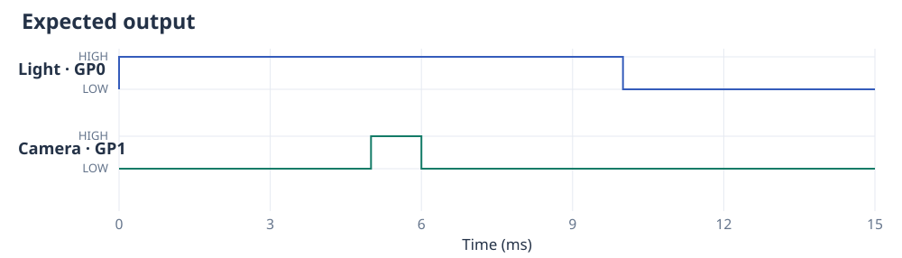

# CtrlAer

[](https://doi.org/10.5281/zenodo.14763862)

CtrlAer is a MicroPython library for controlling the timing of laboratory equipment
using RP2040/RP2350 microcontrollers, for example Raspberry Pi Pico or Pico 2.
Use it to specify when a light, valve, motor or ultrasonic device turns on, how
long it operates, and how several devices work together.

Write a short Python function for each device. CtrlAer combines their instructions
so that their outputs follow the same clock. For example, a light can illuminate
a sample for 10 ms while a camera receives its trigger halfway through:



See the [documentation](https://mehrresearch.github.io/ctrlaer/) for complete
programs, wiring diagrams and explanations.

## Install

Install MicroPython for your board, then run this from the checkout on your
computer with [uv](https://docs.astral.sh/uv/getting-started/installation/):

```sh
uv run tools/install.py
```

Select your board when prompted. The script compiles and installs CtrlAer,
checks the uploaded files and retains the previous library for rollback. Run
it again after updating the checkout to upgrade. See the
[installation guide](docs/installation.md) for firmware and troubleshooting.

## Try an LED

On a Raspberry Pi Pico or Pico 2, the built-in LED is connected to GP25.
Connect USB and run this on the board; no extra components are needed:

```python
from ctrlaer import CtrlAer, HIGH, OFF
from machine import Pin

LED_PIN = 25

def blink():
    for _ in range(3):
        yield HIGH, 500
        yield OFF, 500

controller = CtrlAer(sm_number=0, base_pin=LED_PIN, n_pins=1)
try:
    controller.run(blink())
    controller.block()
finally:
    controller.close()
    Pin(LED_PIN, Pin.OUT, value=0)
```

The LED flashes three times, with half a second on and half a second off.
`finally` stops the controller and leaves the LED off even if you interrupt the
program. The [getting-started guide](docs/getting-started.md) explains each part,
includes an optional circuit with a 1 kΩ resistor for boards without a suitable
built-in LED, then shows how to produce short groups of square waves for a driver input.

## Build an experiment

- [Coordinate several outputs](docs/examples.md) with `mux()`.
- [Wait for external triggers](docs/triggers-and-groups.md), once or before each repetition.
- [Prepare and replay a sequence](docs/prepared-execution.md), or [run a long experiment](docs/execution-modes.md).
- [Measure digital output](docs/digital-capture.md) with the Pico itself or a second board.
- [Preview timing and save results](docs/analysis-and-records.md) on the Pico or your computer.
- [Compare timing and memory requirements](docs/performance.md) for valves, camera triggers, ultrasound and frequency sweeps.

## Read the docs locally

```sh
uv run mkdocs serve
```

Open the address printed in the terminal. Use `uv run mkdocs build --strict` to
check the complete site. To update the reference after changing a public
docstring, run `uv run tools/build_api.py`; regenerate the diagrams with
`uv run tools/build_figures.py`.

## Citing CtrlAer

If you use CtrlAer in your research, please cite:

Mehr, S. H. M. CtrlAer: Programmable real-time execution of scientific experiments
using a domain specific language for the Raspberry Pi Pico/Pico 2. *SoftwareX*
**30**, 102175 (2025). [https://doi.org/10.1016/j.softx.2025.102175](https://doi.org/10.1016/j.softx.2025.102175)

```bibtex
@article{Mehr2025CtrlAer,
  author = {Mehr, S. Hessam M.},
  title = {{CtrlAer}: Programmable real-time execution of scientific experiments using a domain specific language for the {Raspberry Pi Pico/Pico 2}},
  journal = {SoftwareX},
  volume = {30},
  pages = {102175},
  year = {2025},
  doi = {10.1016/j.softx.2025.102175},
  url = {https://doi.org/10.1016/j.softx.2025.102175}
}
```

The [citation page](docs/citing.md) also provides a
[downloadable BibTeX file](docs/ctrlaer.bib) and
[research using CtrlAer](docs/citing.md#research-using-ctrlaer).

## License

This project is licensed under the MIT License - see the LICENSE file for details.
