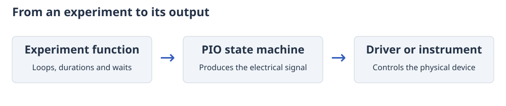

# How CtrlAer produces a signal

The Pico can keep changing a pin while Python does other work. The RP2040 and RP2350 have
**PIO (Programmable I/O) state machines** built into the chip. CtrlAer gives one
of these state machines the instructions needed to produce your signals.

## From the program to the pin

With the original `run()` interface, a command describes either a constant level
or a square wave at the controller's frequency. The PIO state machine repeats that
pattern for the specified duration. Python supplies later commands through a
small hardware queue. An `ON` instruction describes the whole group of cycles,
so a longer square wave does not need more stored output data.

For adjustable square waves, sweeps and external waits, CtrlAer can instead
calculate the times at which the output must change. The microcontroller's
**direct memory access (DMA) system** transfers these instructions from memory
to PIO. Storing individual changes allows more control over the waveform, but
uses more memory: 20 ms of a 100 kHz square wave takes about 32 KiB.

A prepared experiment stores the complete set of instructions before starting.
A buffered experiment stores a few sections ahead and calculates more as it
runs. The [execution guide](execution-modes.md) explains when each approach is
useful and what it costs in memory.

## Completion and messages

The PIO state machine controls the signal itself. Python checks whether an
experiment has finished, handles console messages and reports errors. As a
result, a console message may appear slightly after the output event it
reports. Use [signal capture](digital-capture.md) when you need to measure the
actual time at which a pin changed.

The hardware resources are limited: a Pico has eight PIO state machines and a
Pico 2 has twelve. A controller uses one, and a capture uses another. CtrlAer
checks that two controllers do not accidentally claim the same state machine or output.
