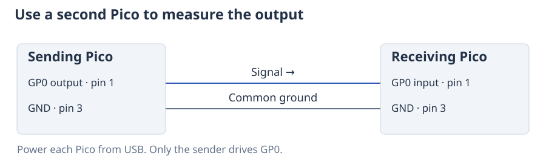

# Measure a digital signal

You can use a Pico to check when a signal goes HIGH or LOW, count its pulses,
and compare its timing with your program. `DigitalCapture` samples the input
at regular intervals and saves the result. It can measure the Pico's own output
or a signal connected from another device.

This checks digital timing. It does not show voltage overshoot, noise or other
analogue details that you would inspect with an oscilloscope.

## Choose the connection

=== "Check the Pico's own output"

    The example below generates a square wave on GP0 and measures GP0 using a
    second PIO state machine in the same Pico. Both can use the pin at once; no
    connection between two pins is needed. This is a convenient first check,
    although the generator and sampler share the Pico's clock.

=== "Use a second Pico"

    Connect the sending Pico's output to the receiving Pico's GP0, and connect
    their grounds. On a standard Pico, GP0 is physical pin 1 and GND is pin 3.
    On the receiving board, configure `Pin(0, Pin.IN)` and start the capture
    before starting the sender. Each board uses its own clock, so small clock
    differences can accumulate during a long measurement.

    

=== "Measure an instrument"

    Connect the instrument's digital output to GP0 and its signal ground to
    Pico GND. Configure `Pin(0, Pin.IN)` before capturing. Use a 3.3 V logic
    signal; a higher-voltage output needs a suitable level converter.

## Record a short square wave

The example produces 2 ms of a 40 kHz square wave: 80 cycles. The sampler takes
two million measurements per second, giving one measurement every 0.5 µs and
about 50 samples per cycle.

```python
from ctrlaer import CtrlAer, square_wave, Trigger, DigitalCapture

def experiment():
    yield square_wave(freq=40_000), 2

controller = CtrlAer(sm_number=0, base_pin=0, n_pins=1)
capture = DigitalCapture(sm_number=4, base_pin=0, sample_hz=2_000_000,
                         duration_ms=3, trigger=Trigger(pin=0))
try:
    run = controller.prepare(experiment())
    capture.start()  # Wait for GP0 to rise before taking the first sample.
    run.start().wait(timeout_ms=1000)
    trace = capture.wait(timeout_ms=1000)
    print(trace.summary())
    print(trace.compare(run.program, tolerance_ns=1000))
    with open("signal.vcd", "w") as stream:
        trace.write_vcd(stream)
finally:
    capture.close()
    controller.close()
```

Start the capture first so that it is ready for the signal's first rising edge.
Its three-millisecond recording covers the two-millisecond square wave and a
little of the final LOW output. The timeout prevents the program from waiting
forever if no signal arrives.

The output uses PIO state machine 0; capture uses state machine 4. Each claims its own
hardware resources. Capture observes the pin without changing it from an output
to an input. When measuring an external signal, configure that pin as an input
yourself, as described in the connection tabs above.

## Understand the comparison

`trace.compare()` checks the sequence of HIGH and LOW changes and their times.
By default it aligns the measured and expected signals using their first edges,
then checks all channels against that common starting point. The tolerance here
is 1 µs, or two sample intervals. It accommodates the uncertainty of locating
an edge between samples; it does not improve the sampler's resolution.

Because capture starts on the first rising edge, the first sample may already
be HIGH. That initial HIGH is a level, rather than a recorded transition, so
the trace can report 79 rising edges for this 80-cycle signal. The comparison
accounts for that starting point.

Inspect both the mismatches and the reported coverage. A recording that ends
before the experiment does cannot establish agreement for the whole experiment.
With an external trigger or gate, the comparison also needs the actual waiting
times; the prepared program cannot predict when another instrument will signal.
The [API reference](api-reference.md) explains `gate_wait_ticks` and partial
comparisons.

## Inspect or save the measurements

Open `signal.vcd` in a digital waveform viewer. `trace.write_csv(stream)` exports
the transitions as a table. In Python, `trace.edges(channel=0)` gives the sample
position and new level of each transition; `trace.timestamps(channel=0)` gives
its time in nanoseconds from the beginning of the recording.

The samples stay available after `capture.close()`. Reusing the capture with
`arm()` overwrites its buffer, so export or copy the trace before doing that.
You can also include it in an [experiment record](analysis-and-records.md#save-what-you-ran).

## Choose a recording length and sample rate

More samples give a longer recording or finer timing resolution, at the cost of
memory. The default limit is 64 KiB. A one-channel recording packs 32 samples
into each four-byte word: at 2 million samples/s, 64 KiB holds about 262 ms.
More channels shorten that time because each sample stores more bits.

The maximum sampling rate is half the Pico's system-clock frequency. The result
reports the actual rate, which may differ slightly from the request. Capture
uses one PIO state machine and one DMA channel. A transfer that falls behind raises
`CaptureOverrunError`; that recording cannot be used as evenly spaced samples.
