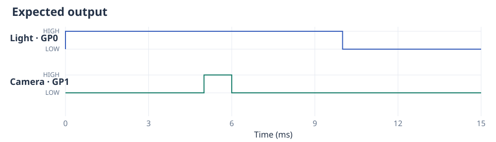
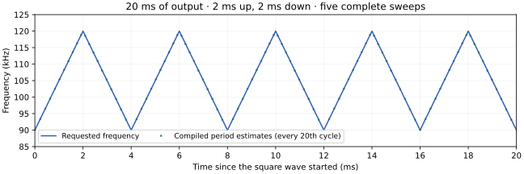
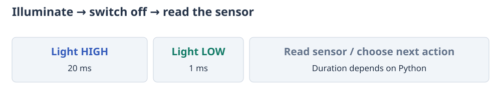

# Control several devices

An experiment often needs more than one output: a light and a camera, two
reagent sources, or a pair of complementary driver inputs. Write one function
for each channel, then use `mux()` to run their instructions on the same clock.
The first function controls GP0, the second GP1, and so on.

Choose an example below. Each shows the signal, a complete program and the
connections. The light/camera, two-output, sweep and trigger examples repeat
until stopped with Ctrl-C. Their plots show the beginning of the output; the
same pattern continues. The complementary-output and sensor examples are short
sequences that finish on their own.

=== "Light and camera"

    The light turns on for 10 ms. Five milliseconds after it turns on, the
    camera receives a 1 ms trigger. Both then stay LOW until the end of a 100 ms
    cycle. Here `HIGH` means a constant 3.3 V control level, not a square wave.

    ```python
    from ctrlaer import CtrlAer, HIGH, OFF, mux
    from machine import Pin

    def light():
        while True:
            yield HIGH, 10
            yield OFF, 90

    def camera():
        while True:
            yield OFF, 5
            yield HIGH, 1
            yield OFF, 94

    controller = CtrlAer(sm_number=0, base_pin=0, n_pins=2, freq=1000)
    try:
        controller.run(mux([light(), camera()]))
    finally:
        controller.close()
        Pin(0, Pin.OUT, value=0)
        Pin(1, Pin.OUT, value=0)
    ```

    

    Connect GP0 to the light's driver input and GP1 to the camera's trigger input,
    and join their signal grounds to Pico GND. Check that both inputs accept 3.3 V
    logic. GP0 and GP1 are physical pins 1 and 2 on a standard Pico.

=== "Two square waves"

    Channel A produces the same 2 ms / 8 ms pattern. Channel B starts each burst
    5 ms later. Both functions repeat the ten-millisecond cycle; `mux()` keeps their relative timing
    while assigning them to GP0 and GP1.

    ```python
    from ctrlaer import CtrlAer, ON, OFF, mux
    from machine import Pin

    def a():
        while True:
            yield ON, 2
            yield OFF, 8

    def b():
        while True:
            yield OFF, 5
            yield ON, 2
            yield OFF, 3

    controller = CtrlAer(sm_number=0, base_pin=0, n_pins=2, freq=40000)
    try:
        controller.run(mux([a(), b()]))
    finally:
        controller.close()
        Pin(0, Pin.OUT, value=0)
        Pin(1, Pin.OUT, value=0)
    ```

    

    Connect GP0 to the first device's input and GP1 to the second device's input.
    Connect both devices' grounds to Pico GND. Each solid band contains 80 cycles
    of the square wave; they are too close together to show at this scale.
    When one function finishes, its output stays LOW while the others continue.

    For independent frequencies, see
    [groups](triggers-and-groups.md#let-one-channel-wait-independently-with-group).

=== "Duty cycle and dead time"

    <a id="set-duty-cycle-and-complementary-dead-time"></a>

    This 0.2 ms burst has a 40 kHz square wave: eight periods of 25 µs. The ideal A
    waveform is HIGH for 40% of a period. Its complementary partner has the remaining
    60%. A 200 ns turn-on delay leaves both outputs LOW at every handover.

    ```python
    from ctrlaer import CtrlAer, square_wave, mux

    def a():
        yield square_wave(40000, duty=.4, dead_time_ns=200), .2

    def b():
        yield square_wave(40000, duty=.4, complement=True, dead_time_ns=200), .2

    controller = CtrlAer(sm_number=0, base_pin=0, n_pins=2)
    try:
        controller.prepare(mux([a(), b()])).start().wait(1000)
    finally:
        controller.close()
    ```

    

    The 100 µs view shows four of the eight periods. GP0 turns on 200 ns after each
    ideal rising edge, turns off at the ideal falling edge, and GP1 turns on 200 ns
    later. The delay reduces actual HIGH time; it is not added to the period.
    Both return LOW at completion. Connect GP0/GP1 to the two compatible logic
    inputs of the intended driver, with common GND.

    `phase=.25` would delay the first ideal rising edge by one quarter of a cycle.
    Apply matching square-wave settings to complementary partners. Impossible duty/dead
    time combinations and intervals below six ticks of the Pico’s system clock fail preparation.
    The source factory is `complementary()` in `examples/patterns.py`.

=== "Frequency sweep"

    <a id="sweep-repeatedly-within-one-pulse"></a>

    Each repetition runs the square wave for 20 ms, then pauses for 100 ms. Its frequency goes from 90 kHz to 120 kHz in 2 ms, returns
    in another 2 ms, then repeats. The output therefore contains five complete
    up-and-down sweeps and 2100 cycles. Ending the output earlier stops it at
    that point; changing its duration does not change the sweep rate.

    ```python
    from ctrlaer import CtrlAer, sweep, OFF

    def experiment(duration_ms=20, sweep_ms=2):
        while True:
            yield sweep(90000, 120000, sweep_ms=sweep_ms), duration_ms
            yield OFF, 100

    controller = CtrlAer(sm_number=0, base_pin=0, n_pins=1)
    try:
        run = controller.prepare(experiment, mode="buffered")
        run.start().wait()
    finally:
        controller.close()
    ```

    

    

    

    The frequency graph shows the five sweeps. The square wave continues smoothly
    when the frequency changes direction. With `sweep_ms=2`, each journey takes
    2 ms; omitting it uses 20 ms per journey.

    Connect GP0 to your device's input and connect its ground to Pico GND.
    The effect of a sweep on a transducer depends on that device; check its response
    when choosing a frequency range. See [previews and scans](analysis-and-records.md)
    to compare different settings, or [buffering](execution-modes.md) to repeat
    a sweep without storing the entire experiment.

=== "Repeated triggers"

    <a id="wait-for-another-trigger-on-every-shot"></a>

    This program runs indefinitely. It waits for LOW then HIGH on GP6, produces a
    20 ms burst on GP0, holds GP0 LOW for 100 ms, and returns to the next gate.
    Edges during the burst or rest are not queued for later shots.

    ```python
    from ctrlaer import CtrlAer, square_wave, OFF, wait_for
    from machine import Pin

    Pin(6, Pin.IN, Pin.PULL_DOWN)

    def shots():
        while True:
            wait_for(6, timeout_ms=None)
            yield square_wave(108050), 20
            yield OFF, 100

    controller = CtrlAer(sm_number=0, base_pin=0, n_pins=1)
    try:
        run = controller.prepare(shots, mode="buffered")
        run.start().wait()
    finally:
        controller.close()
    ```

    

    The diagram shows two repetitions, with the unknown waiting times left out.
    Each dashed line marks a wait for input. In a measurement of the real output,
    the LOW intervals can be longer while the experiment waits for a trigger.

    Connect a 3.3 V trigger source to GP6 and its ground to Pico GND. GP0 connects
    to your device's input. The [trigger example](triggers-and-groups.md) shows
    the instrument and pushbutton connections; choose one source of triggers.
    Stop with Ctrl-C at the REPL, or call `run.abort()` from your application.
    With `timeout_ms=None`, the input wait can last as long as needed.

## Use Python measurements between commands

Suppose you want to switch a light on for 20 ms, switch it off, and then read a
sensor. With
[eager execution](execution-modes.md#eager-measurements-and-ordinary-python-in-sequence),
the sensor is read after the light has been switched off. This lets you use the
measurement to decide what to do next.

```python
from ctrlaer import CtrlAer, HIGH, OFF
from machine import ADC, Pin

sensor = ADC(26)  # Sensor's analogue output connects to GP26.

def measure():
    yield HIGH, 20                 # Illuminate the sample for 20 ms.
    yield OFF, 1                   # Switch the light off; wait 1 ms.
    reading = sensor.read_u16()     # Read the sensor with the light off.
    print("Sensor reading:", reading)

controller = CtrlAer(sm_number=0, base_pin=0, n_pins=1, freq=1000)
try:
    controller.run(measure(), mode="eager")
finally:
    controller.close()
    Pin(0, Pin.OUT, value=0)
```

Connect GP0 to the light's driver input, or use the
[LED circuit](getting-started.md#if-your-board-has-no-built-in-led). Connect the sensor's analogue output to GP26
(physical pin 31 on a Pico), and connect both devices' grounds to Pico GND. The
sensor output must stay between 0 and 3.3 V. `read_u16()` returns a number from
0 to 65535; converting that number to a physical measurement depends on the
sensor.

The Pico controls the duration of each signal, but reading the sensor and
preparing the next signal take additional time. The output stays at its last
level during that work, so include an `OFF` instruction before the measurement
if the light should be off. Use this approach when measurements determine the
next action and the time between actions can vary.


