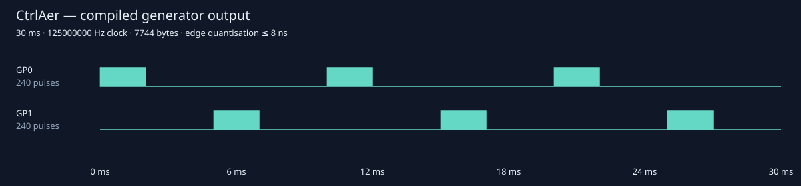
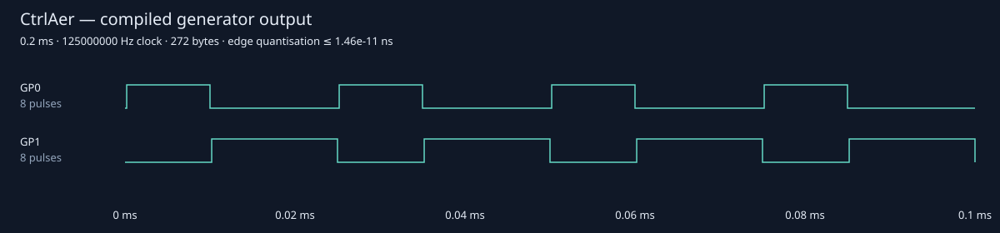
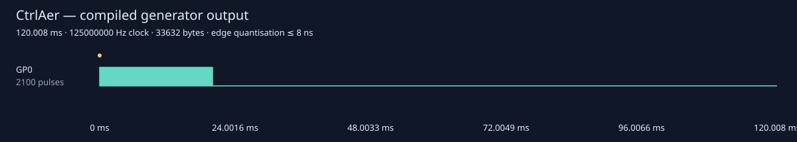
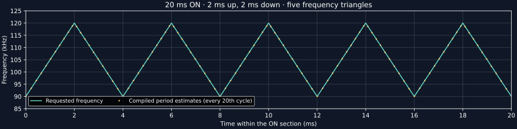
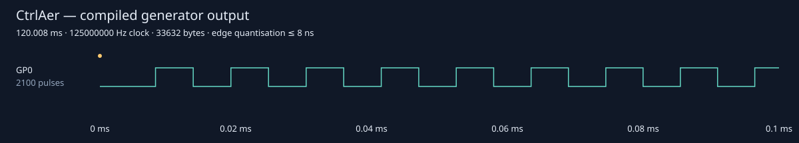
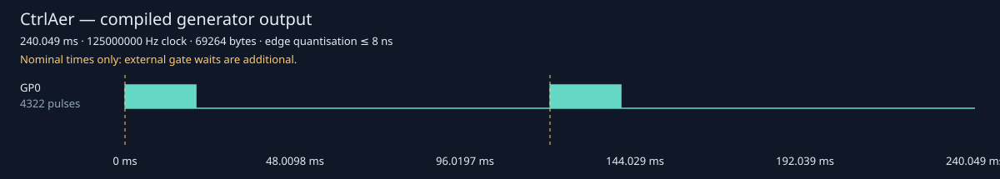

# Worked waveform examples

These examples use the existing generator vocabulary. Code runs on a board after
[installation](installation.md); the figures come from the actual desktop
compiler, at a 125 MHz system clock. A Pico Plus 2 uses its current clock instead.
The figures describe digital GPIO output, rather than the response of a load.

The [original FIFO recipes](original-recipes.md) explain the pre-existing
stepper, timing, ultrasonic, blocking and USB-listener scripts, with their
nominal waveforms and physical connections.

| Example | Output pins | What to observe |
|---|---|---|
| Three short bursts | GP6 | Burst envelope and individual carrier periods |
| Staggered channels | GP0, GP1 | A 5 ms offset between two burst trains |
| Complementary outputs | GP0, GP1 | Duty cycle and a LOW gap at every handover |
| Triangular sweep | GP0 | Frequency reversals while carrier phase stays continuous |
| Repeated hardware triggers | GP0 output, GP6 input | One shot for each edge received while the gate is ready |

GPIO numbers differ from header position numbers. The [wiring guide](wiring.md)
gives physical positions on the Tiny 2040 and Pico Plus 2. Driver inputs and the
board must share a logic ground. Use a suitable power driver for an atomiser,
bridge, motor or valve.

## Three short bursts

The [getting-started example](getting-started.md#three-short-bursts) generates
three 2 ms bursts at 40 kHz, each followed by 8 ms LOW. Each burst contains 80
carrier periods. The source factory is `bursts()` in `examples/patterns.py`.


An envelope plot is useful for experiment timing. The zoom is necessary to see
the LOW-first `ON` command and its 25 µs period.

## Stagger two channels

Channel A produces the same 2 ms / 8 ms pattern. Channel B starts each burst
5 ms later. Both generators last 30 ms; `mux()` keeps their relative timing
while assigning them to GP0 and GP1.

```python
from ctrlaer import CtrlAer, ON, OFF, mux

def a():
    for _ in range(3):
        yield ON, 2
        yield OFF, 8

def b():
    for _ in range(3):
        yield OFF, 5
        yield ON, 2
        yield OFF, 3

controller = CtrlAer(0, base_pin=0, n_pins=2, freq=40000)
try:
    controller.prepare(mux([a(), b()])).start().wait(1000)
finally:
    controller.close()
```



Connect GP0 and GP1 to separate logic inputs on your drivers, and join their
logic grounds to board GND. The diagram shows burst envelopes; each band contains
80 periods of the same LOW-first carrier shown above. Exhausted `mux()` channels
become LOW while any remaining channel continues.

The equivalent reusable factory is `staggered()` in `examples/patterns.py`.
For different independent carrier frequencies, see [groups](triggers-and-groups.md#independent-waveform-groups).

## Set duty cycle and complementary dead time

This 0.2 ms burst has a 40 kHz carrier: eight periods of 25 µs. The ideal A
waveform is HIGH for 40% of a period. Its complementary partner has the remaining
60%. A 200 ns turn-on delay leaves both outputs LOW at every handover.

```python
from ctrlaer import CtrlAer, pulse, mux

def a():
    yield pulse(40000, duty=.4, dead_time_ns=200), .2

def b():
    yield pulse(40000, duty=.4, complement=True, dead_time_ns=200), .2

controller = CtrlAer(0, base_pin=0, n_pins=2)
try:
    controller.prepare(mux([a(), b()])).start().wait(1000)
finally:
    controller.close()
```



The 100 µs view shows four of the eight periods. GP0 turns on 200 ns after each
ideal rising edge, turns off at the ideal falling edge, and GP1 turns on 200 ns
later. The delay reduces actual HIGH time; it is not added to the period.
Both return LOW at completion. Connect GP0/GP1 to the two compatible logic
inputs of the intended driver, with common GND.

`phase=.25` would delay the first ideal rising edge by one quarter of a cycle.
Apply matching carrier settings to complementary partners. Impossible duty/dead
time combinations and intervals below six system-clock ticks fail preparation.
The source factory is `complementary()` in `examples/patterns.py`.

## Sweep repeatedly within one pulse

The pulse lasts 20 ms. Its frequency goes from 90 kHz to 120 kHz in 2 ms, returns
in another 2 ms, then repeats. The pulse therefore contains five complete
frequency triangles and 2100 carrier cycles. Changing pulse duration clips this
same trajectory; it does not change the sweep rate.

```python
from ctrlaer import CtrlAer, chirp, OFF, print

def experiment(pulse_ms=20, sweep_ms=2):
    print("adiabatic shot", pulse_ms, sweep_ms)
    yield chirp(90000, 120000, sweep_ms=sweep_ms), pulse_ms
    yield OFF, 100

controller = CtrlAer(0, base_pin=0, n_pins=1)
try:
    controller.prepare(experiment()).start().wait(1000)
finally:
    controller.close()
```







The frequency graph starts at the beginning of the ON section. It shows the
requested trajectory and frequency estimates from compiled rising-edge periods.
Carrier phase remains continuous at every reversal. `chirp` defaults to a
20 ms **one-way** sweep when `sweep_ms` is omitted; it does not infer a sweep rate
from the pulse duration.

The imported `print` is CtrlAer's managed notification. It becomes an event in
the compiled schedule, with two 512-tick control packets before the ON section
(8.192 µs at 125 MHz). Its console text is serviced by Python; notification latency
does not retime the carrier. The actual GPIO schedule includes that fixed
overhead, which is visible before the first pulse in the zoom.

Connect GP0 to the driver's logic input and common GND. Electrical waveform
verification does not establish the atomiser's mechanical or aerosol response.
The parameterised source is `examples/adiabatic.py`; see
[scans and records](analysis-and-records.md) for exploring parameters and saving
exact programs. Use buffered mode for a repeating unbounded generator, subject
to the [production envelope](performance.md).

## Wait for another trigger on every shot

This program runs indefinitely. It waits for LOW then HIGH on GP6, produces a
20 ms burst on GP0, holds GP0 LOW for 100 ms, and returns to the next gate.
Edges during the burst or rest are not queued for later shots.

```python
from ctrlaer import CtrlAer, pulse, OFF, wait_for
from machine import Pin

Pin(6, Pin.IN, Pin.PULL_DOWN)

def shots():
    while True:
        wait_for(6, timeout_ms=None)
        yield pulse(108050), 20
        yield OFF, 100

controller = CtrlAer(0, base_pin=0, n_pins=1)
try:
    run = controller.prepare(shots, mode="buffered")
    run.start().wait()
finally:
    controller.close()
```



This figure compiles two iterations of the same pattern. Dashed markers identify
gates at their **nominal** positions. No duration is invented for the unknown
external waits; a real capture can contain arbitrarily long LOW intervals there.
Fixed gate-control overhead is included. A shot starts only after the gate is
ready and the requested edge is received.

Connect a 3.3 V trigger source to GP6 and its GND to board GND. GP0 is the drive
output; the [physical wiring guide](wiring.md#trigger-an-experiment) identifies
both boards' pads. Stop with `run.abort()` from application code, or interrupt
the synchronous wait; `finally` closes the engine. `timeout_ms=None` is an
unbounded gate wait, whereas a numeric timeout is supervised in software.
See [trigger semantics](triggers-and-groups.md) for edge preconditions, timeout
latency and rearming. `triggered()` in `examples/patterns.py` provides a finite
version for analysis.

## Use Python measurements between commands

[Eager execution](execution-modes.md#eager-measurements-and-ordinary-python-in-sequence)
finishes a yielded command before advancing Python. Choose it when an ADC
reading or other ordinary Python operation must happen after that command.
Each command still uses PIO/DMA, while gaps between commands include interpreter
and preparation time. The last digital level is held during those gaps; issue
an explicit OFF command first when a measurement needs deasserted output.


## Reproduce the figures

From the checkout on your computer:

```sh
uv run tools/build_figures.py
```

The script regenerates these waveforms from the real compiler and the source
factories. Its PEP 723 metadata supplies Matplotlib for the frequency figure.
It contacts no board. The wiring diagram is separately checked against the
manufacturer's pinouts.
