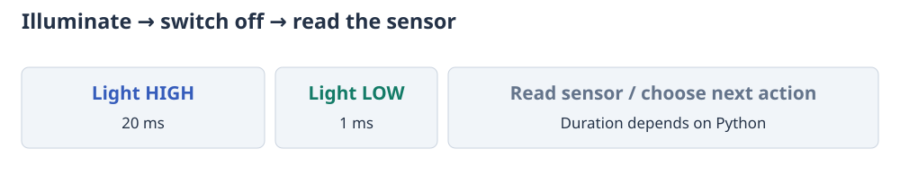

# Choose how a generator executes

All modes use the same `(command, duration)` generator vocabulary. The choice
controls when Python advances and how much waveform data is prepared ahead.

| Mode | Entry point | Python advances | Output timing | Memory |
|---|---|---|---|---|
| Finite prepared | `prepare(program)` | Before starting | PIO/DMA throughout the prepared program | Grows with the compiled waveform |
| Buffered | `prepare(program, mode="buffered")` | With bounded lookahead during playback | PIO/DMA across chunk boundaries while production keeps up | Fixed-size waveform buffers |
| Eager | `run(program, mode="eager")` | After each yielded command finishes | PIO/DMA within a command; Python gaps between commands | Fixed-size waveform buffers |
| Original FIFO | `run(program)` | While feeding the small hardware FIFO | Original shared-frequency oscillator | Small FIFO; integer commands only |

`prepare` returns an inactive run. Call `start()` to enable output, then `wait()`
to supervise it synchronously. A soft timer also services an active run, allowing
the application to do other work after `start()`. Python work still shares the
interpreter with buffered production: long blocking calls can miss a deadline.
On the PSRAM-enabled Pico Plus 2 firmware, even `gc.mem_alloc()`/`gc.mem_free()`
can block for roughly 158 ms while scanning the heap. Inspect heap statistics
before starting, after stopping, or while a hardware gate deliberately pauses
the waveform; do not use them as live per-refill instrumentation.

## Buffered: indefinite programs with hardware triggers

```python
from ctrlaer import CtrlAer, pulse, OFF, wait_for
from machine import Pin

Pin(6, Pin.IN, Pin.PULL_DOWN)

def shots():
    while True:
        wait_for(6, timeout_ms=None)
        yield pulse(108050), 20
        yield OFF, 100

controller = CtrlAer(0, 0, 1)
try:
    run = controller.prepare(shots, mode="buffered", buffer_words=4096)
    run.start().wait()  # Runs until abort, an error, or interruption.
finally:
    controller.close()
```

GPIO0 is the drive output; GPIO6 receives a 3.3 V logic trigger, and the trigger
source shares ground with the board. Use the board's **GPIO labels**, not header
position numbers. See [triggers](triggers-and-groups.md) for wiring and edge
semantics. Each new rising edge produces one burst after the gate has observed
LOW then HIGH. Edges during the burst/rest are not queued. A gate can wait forever
without accumulating waveform data or imposing a total program-duration limit.

An initial `trigger=Trigger(...)` waits once before the first command. A
`wait_for(...)` inside the loop waits again on each iteration. Trigger waits run
in PIO; they do not poll the pin from Python.

### What a chunk boundary does

Chunk boundaries do not introduce a new output edge, apply `final_mask`, restart
carrier phase or restart a frequency sweep. A single yielded command may span
many chunks. For example, a 1 s chirp with `sweep_ms=2` continues through 250 up/down
frequency triangles without storing a 1 s waveform in RAM.

The runtime uses four chained transmit DMA channels and one prepared spare
buffer. An allocation-free DMA interrupt installs the ready spare into a
completed channel; Python fills the newly freed buffer. This leaves several
chunks of hardware playback ahead of Python, including time to absorb occasional
interpreter pauses. Sparse chunks transfer only their actual word count.

Every internal chunk ends with a blocking guard until its successor is ready.
Publishing a successor changes that guard to a NOP. Its time is
taken from an existing hold, preserving nominal edge times. If the producer is
late, the guard prevents stale cyclic DMA data from being replayed. The soft
service reports `UnderrunError`, stops playback and drives `final_mask`.

An error may leave the last digital level asserted until the software service
handles it. This is an error-detection mechanism, not a hardware safety interlock.

### Buffer size and resources

`buffer_words` is the capacity of **each** buffer and must be a power of two from
32 to 8192. Five waveform buffers are retained; alignment requires an allocation
of six times `buffer_words * 4` bytes. At the default 4096 words this allocation
is 96 KiB. Edge scratch space, event reception, metadata and an optional bounded
chirp cache also need storage. At the default capacity, edge scratch reuses the
pool's alignment slack outside all DMA read rings; it needs no additional 8 KiB
allocation. The two 1 KiB event-receive rings also occupy disjoint portions of
that slack, avoiding separate aligned receive allocations. Smaller capacities
can require separate scratch/receive storage.

Chirps whose phase does not repeat use a bounded inverse-phase lookup instead.
The table is independent of ON duration, but changing sweep settings can require
a new contiguous allocation. The Tiny's non-moving heap can reject that
allocation after other work has fragmented memory, even when a clean interpreter
can run the same waveform. Keep buffers/tables within the available heap;
the PSRAM-enabled Pico Plus 2 has substantially more room.

Each buffered run claims one PIO state machine, four TX DMA channels and two RX
DMA channels. Two such runs use all twelve DMA channels of an RP2040; digital
capture needs another channel. RP2350 has sixteen DMA channels. Available heap and channels depend on other application
activity; larger buffers can fail allocation on a Tiny.

Dense waveforms consume a buffer sooner than sparse holds. Increasing buffer
size absorbs longer scheduling pauses but cannot fix a producer whose average
rate is below the playback rate. An interval also needs room for the guard's six
ticks. Extremely dense schedules that cannot place a time-neutral guard are
rejected explicitly. See [performance](performance.md) for measured costs and
parameter ranges.

### Python effects and bounded state

Generator code runs ahead of the corresponding output. Global assignments,
ordinary `print`, file I/O and arbitrary Python calls happen during lookahead.
CtrlAer accepts those side effects; it does not attempt to undo or analyse them.

Use CtrlAer's `sleep`, `print` and `wait_for` for operations that belong to playback
order. Sleep holds the last digital mask; it does not continue a completed
carrier. Print notifications and timeout supervision have interpreter/service
latency. GPIO waits and waveform edges remain hardware timed.

A generator must yield regularly: up to 64 managed effects may be queued during
one advance by default (`max_pending_effects`). This bounds an effects-only loop
that would otherwise never return control to the compiler. The program itself
can still allocate or retain arbitrary user data.

`gate_history` and `effect_history` retain the latest 128 observations by default.
Use `history_limit` to change that bound or `0` to retain none. Event marker IDs
roll over without growing the receive buffers. Receive-ring corruption or loss
is an explicit error.

Pass a generator **factory** to allow `rearm()` after completion or abort. A
consumed iterator cannot be rewound; a buffered run prepared from one must be
replaced with a fresh iterator. Closing a buffered run releases its waveform
buffers even if you retain the closed run object. Replacing an inactive open
buffered run through `controller.prepare(...)` reuses its waveform pool when
the capacity matches, avoiding a second large allocation on a fragmented heap.
Its generator, phase, markers and receive rings are reset for the new run.

## Eager: measurements and ordinary Python in sequence

```python
from ctrlaer import CtrlAer, pulse, OFF, sleep, print
from machine import ADC

sensor = ADC(ADC.CORE_TEMP)  # Internal temperature channel; no external wiring.

def feedback():
    while True:
        yield pulse(108050), 20
        yield OFF, 100
        reading = sensor.read_u16()  # Both preceding commands have finished.
        print("raw temperature ADC:", reading)
        sleep(0.1)

controller = CtrlAer(0, 0, 1)
try:
    controller.run(feedback(), mode="eager")
finally:
    controller.close()
```



The schematic shows execution order; Python gaps have no prescribed duration.
The ADC is internal, so it needs no wiring. GP0 is the drive output; connect a
compatible driver input and common GND as shown in the [wiring guide](wiring.md).
`ADC.CORE_TEMP` selects the firmware's internal-temperature channel across the
two chip packages; see [MicroPython's RP2 ADC implementation](https://github.com/micropython/micropython/blob/master/ports/rp2/machine_adc.c).

Eager execution finishes one yielded command before resuming Python. The ADC
read therefore happens after the burst and its 100 ms LOW rest. This example prints a raw ADC reading;
it does not convert or calibrate a temperature. The carrier remains PIO/DMA timed,
and long commands are still chunked with bounded memory.

Between commands, the last digital level is held while Python runs and the next
command is prepared. Reusing the engine does not reinitialise the pins to LOW.
Those gaps are deliberately not real-time; their duration includes Python work,
compilation, garbage collection and service overhead. Managed sleep preserves
the same level, and managed gates use the same PIO wait mechanism as buffered
execution. Use explicit OFF/LOW commands when you want an output deasserted
before a measurement or other Python operation.
After a gate releases, Python resumes and prepares the next command too. Use
buffered execution when the output must follow a trigger with only the fixed
PIO control overhead.

Eager `run` is synchronous (`block=False` is rejected). Normal EOF, abort and
errors apply `final_mask`. A Python generator exception also applies that mask
before propagating the exception. The returned run object can be inspected and
closed after a finite eager program. Histories, elapsed time and production
counters cover the whole eager run, including Python/preparation gaps. An abort
or close between fragments prevents later commands from playing. Ordinary
Python already executing resumes until its next yield or managed operation.

## Keep finite analysis for reviewable experiments

Finite preparation is useful when you want to validate the whole waveform,
preview it, save its exact packets or replay the same data repeatedly. It cannot
consume an infinite generator without an explicit finite analysis window.

A buffered run has no single complete `CompiledProgram`: its future may depend
on Python that has not executed yet. To preview an indefinite generator, use
`compile_program(factory, window_ms=...)` on a separate invocation. That preview
also runs arbitrary Python side effects, just like other analysis.

The original `run(program)` remains available for existing integer-command
programs. Its `block` argument controls waiting for FIFO space, not waiting for
the last output to finish. Call `controller.block()` to wait for completion, and
retain the returned iterator when using `block=False`. Explicit eager/buffered
`run` modes have the execution semantics described above.
