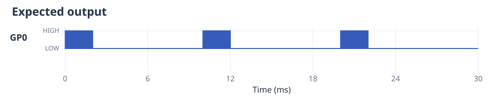
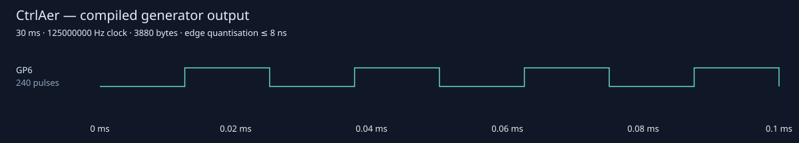

# Your first waveform

CtrlAer programs are Python generators that yield `(command, duration)` pairs.
Keep using loops, functions, variables and `mux()` to build experiments. The
execution mode determines when Python runs and how much waveform data is
prepared ahead of the hardware.

[Install CtrlAer](installation.md) on a board running MicroPython first. The code
below runs **on the board**, for example from its REPL. Desktop Python can
compile and preview programs, but cannot drive a board's PIO directly.

## Three short bursts

This program produces three 2 ms bursts at 40 kHz. Each contains 80 carrier
periods, followed by 8 ms LOW. The sequence lasts 30 ms, plus the 12 system-clock
ticks used to apply the final mask and signal completion.

```python
from ctrlaer import CtrlAer, ON, OFF

def bursts():
    for _ in range(3):
        yield ON, 2
        yield OFF, 8

controller = CtrlAer(0, base_pin=6, n_pins=1, freq=40000)
try:
    run = controller.prepare(bursts())
    run.start().wait(timeout_ms=1000)
finally:
    controller.close()
```

`prepare()` consumes this finite generator, compiles its waveform and preloads
DMA while playback is disabled. `start()` enables output; `wait()` waits for
hardware completion and reports errors. `close()` releases the state machine
and DMA channels. The default final mask is LOW.



At this scale the carrier edges form solid bands. The first 100 µs reveals four
periods. `ON` is the original `PULSE10` command: LOW in the first half of each
period, HIGH in the second half.



The output is the pin labelled **GP6**, rather than physical pin number 6; see
the [physical-position table](wiring.md). No
external wiring is required to run this example. To observe the signal, connect
a digital input or instrument to GP6 and connect its ground to the board's GND.
GPIO is a 3.3 V logic signal; connect a load through a suitable driver rather
than connecting a motor, valve or atomiser directly to the GPIO.

## Commands and durations

For one channel the original constants have these meanings:

| Command | Value | Output during one carrier period |
|---|---:|---|
| `LOW`, `OFF` | 0 | LOW throughout |
| `PULSE01` | 1 | HIGH, then LOW |
| `ON`, `PULSE10` | 2 | LOW, then HIGH |
| `HIGH` | 3 | HIGH throughout |

Durations normally use milliseconds. Original integer commands use whole
carrier periods: a non-integer number of periods is truncated. At 40 kHz one
period is 25 µs. With `use_ms=False`, a duration is a **number of carrier
periods at the controller's `freq`**, not a number of system-clock ticks.

`pulse(freq, duty=..., phase=...)` and `chirp(...)` supply a command's own
frequency trajectory. Their millisecond durations are compiled to the nearest
system-clock tick. Rich `pulse()` starts with its ideal rising edge at phase
zero; this differs from the LOW-first `ON` constant. See the
[command reference](api-reference.md) and [worked examples](examples.md).

## Running indefinitely

Finite preparation must reach the end of its generator. To use an unbounded
generator, select buffered execution. For the same burst pattern, replace the
`for` loop above with `while True`, prepare with `mode="buffered"`, then call
`run.start()`. Output continues while the producer supplies buffers. Call
`run.abort()` to stop it, and `controller.close()` when finished.

Buffered execution supports hardware triggers and `wait_for()` inside the
generator. It consumes bounded lookahead, so ordinary Python side effects may
occur before their associated output. Use eager execution when Python must
observe each completed command before deciding the next one. See
[execution modes](execution-modes.md) for runnable examples, memory budgets and
timing guarantees.

## Multiple outputs and state machines

`mux([a(), b()])` assigns its generators to consecutive GPIOs starting at
`base_pin`: for example GP6 and GP7 with `base_pin=6, n_pins=2`. Original integer
commands share the controller's carrier. Rich commands can describe independent
carriers, subject to the minimum spacing between merged edges. A `Group` can
start separate prepared state machines together; see
[triggers and groups](triggers-and-groups.md).

RP2040 has eight state machines, numbered 0–7, and RP2350 has twelve, numbered
0–11. Blocks contain four state machines each. Controllers must use different
state machines and non-overlapping output GPIOs. Capture also consumes a state
machine and DMA resources.

The original `controller.run(program)` API remains available. Its `block`
argument controls waiting for FIFO space; it does **not** establish that the
last queued edge has played. Use `controller.block()` for completion with that
API, or choose one of the explicit execution modes above.
