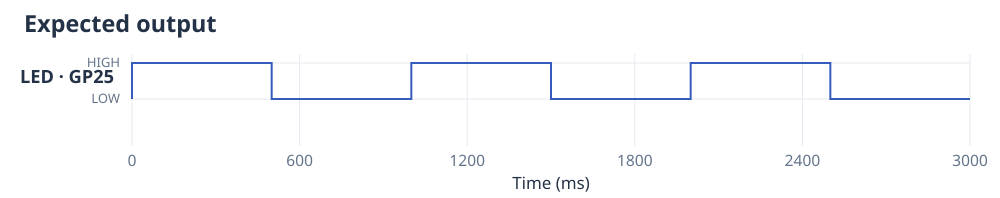
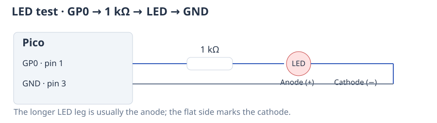
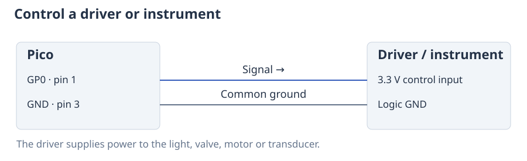

# Getting started

In this tutorial you will flash the Pico's built-in LED three times. You will
then use an external pin to produce short groups of square waves, such as those
used to drive an ultrasonic transducer.

You need a Raspberry Pi Pico or Pico 2 with [MicroPython and CtrlAer installed](installation.md).
The code below runs **on the Pico**, using the MicroPython REPL in Thonny or a
script copied to the board. Your computer supplies power and lets you edit the
program.

## Flash the built-in LED

The non-wireless Raspberry Pi Pico and Pico 2 have an LED connected to **GP25**,
with its resistor built in. Connect the board to your computer by USB; you do
not need any other components or wiring for this first program.

```python
from ctrlaer import CtrlAer, HIGH, OFF
from machine import Pin

LED_PIN = 25  # Built-in LED on a Raspberry Pi Pico or Pico 2.

def blink():
    for _ in range(3):
        yield HIGH, 500
        yield OFF, 500


controller = CtrlAer(sm_number=0, base_pin=LED_PIN, n_pins=1)
try:
    controller.run(blink())
    controller.block()
finally:
    controller.close()
    Pin(LED_PIN, Pin.OUT, value=0)
```

The LED should flash three times. Each flash lasts half a second, with half a
second of darkness after it. The complete sequence lasts three seconds.



### What the function says

`yield HIGH, 500` tells CtrlAer to hold the output HIGH for 500 milliseconds.
`yield OFF, 500` tells it to hold the output LOW for another 500 milliseconds.
The loop repeats those two instructions three times.

A Python function containing `yield` is called a **generator**. Instead of
returning one result, it supplies one instruction at a time. This makes an
experiment easy to build from loops, conditions and smaller functions. You do
not need to turn your whole experiment into a long list of times.

### What the controller does

PIO (Programmable I/O) is hardware built into the RP2040 and RP2350. Its
**state machines** carry out output instructions without a Python loop for
each pin change. `sm_number` selects which state machine the controller uses.

The constructor names three things explicitly:

| Argument | Meaning in this example |
|---|---|
| `sm_number=0` | Use PIO state machine 0. Choose a different free number for another controller. |
| `base_pin=LED_PIN` | Use GP25, which is connected to the built-in LED. The number identifies a GPIO, not a header position. |
| `n_pins=1` | Use one output: the built-in LED. |

`controller.run(blink())` reads the instructions and sends them to the PIO
state machine. `controller.block()` waits for the last instruction to finish before
Python moves on to cleanup. The PIO state machine continues to work while Python
waits.

### Why use `try` and `finally`?

The code inside `finally` runs when the experiment finishes, and also when an
exception occurs or you press **Ctrl-C**. `close()` stops the controller and
releases the PIO state machine so that another program can use it. The final
`Pin(...)` line puts the LED pin LOW, leaving the LED off.

If you omit cleanup, an interrupted program can leave the output running or
leave the pin HIGH. A later program may also report that the PIO state machine is
already in use. Stopping Python alone does not reliably stop a signal produced
by the Pico's PIO hardware. With the original `run()` interface, `close()`
keeps the last pin level, which is why this example sets the LED pin LOW explicitly.

### If your board has no built-in LED

Use a free GPIO such as **GP0** and set `LED_PIN = 0` in the program above.
Connect GP0 through a **1 kΩ resistor** to the LED's anode (usually the longer
leg). Connect its cathode (usually the shorter leg, beside the flat side of
the package) to **GND**. On a Pico, GP0 is physical pin 1 and GND is pin 3.



The resistor limits LED current. If your board has a GPIO-connected LED on a
different pin, use that GPIO number instead. Pico W and Pico 2 W connect their
LED through the wireless chip rather than a GPIO that CtrlAer can drive; use
the external-LED circuit for those boards. The
[official board layouts](https://www.raspberrypi.com/documentation/microcontrollers/pico-series.html#board-layouts)
show this difference.

## Produce a burst of square waves

Some devices need a repeating electrical signal while they are active. For
example, an ultrasonic driver might require a **40 kHz square wave**: 40,000
cycles each second. One cycle consists of a HIGH interval followed by a LOW
interval. At 40 kHz, a cycle lasts 25 microseconds.

A **burst** is a short group of these cycles, followed by a pause. A 2 ms burst
at 40 kHz contains 80 cycles. The next program produces three such bursts,
with 8 ms of LOW output after each one. It uses **GP0**, an external output,
rather than the built-in LED.

To control an ultrasonic device, connect GP0 to the driver's 3.3 V-compatible
signal input and connect Pico GND to the driver's logic ground. On a Pico these
are physical pins 1 and 3. The driver supplies power to the transducer.



You can run the program without a driver to produce the electrical signal.
Use a scope or digital input to inspect GP0; an LED cannot show individual
40 kHz cycles.

```python
from ctrlaer import CtrlAer, ON, OFF
from machine import Pin


def ultrasound():
    for _ in range(3):
        yield ON, 2
        yield OFF, 8


controller = CtrlAer(sm_number=0, base_pin=0, n_pins=1, freq=40_000)
try:
    controller.run(ultrasound())
    controller.block()
finally:
    controller.close()
    Pin(0, Pin.OUT, value=0)
```

`freq=40_000` sets the frequency used by `ON`. `ON` produces the square wave;
`HIGH` would hold the output at 3.3 V without oscillating. `OFF` holds it at 0 V.


The cycles are too close together to distinguish in the full view. The next
figure expands the first 100 µs, where you can see four cycles. `ON` spends half
of each cycle LOW and half HIGH.


An LED will not let you distinguish these individual cycles. To inspect them,
use a scope, logic analyser, or the [Pico's signal capture](digital-capture.md).
An ultrasonic transducer itself needs an appropriate power driver; GP0 provides
that driver's logic signal.

## Change or extend the experiment

The durations after `yield` are in **milliseconds** unless you pass
`use_ms=False`. With that option they are whole square-wave periods: at 40 kHz,
`yield ON, 80` lasts 2 ms. Use milliseconds while learning the interface.

To repeat a sequence until you stop it, replace `for _ in range(3)` with
`while True`. The original `run()` accepts this directly and keeps taking the
next instruction as it needs it. An endless program never reaches the
`controller.block()` line; Ctrl-C still runs the cleanup in `finally`.

When you need two devices to act together, give each one its own function and
combine them with [`mux()`](examples.md). For square waves with adjustable duty
cycle, frequency sweeps or external triggers, continue with the relevant worked
example. [Running an experiment](execution-modes.md) explains the available
execution controls and their trade-offs.
