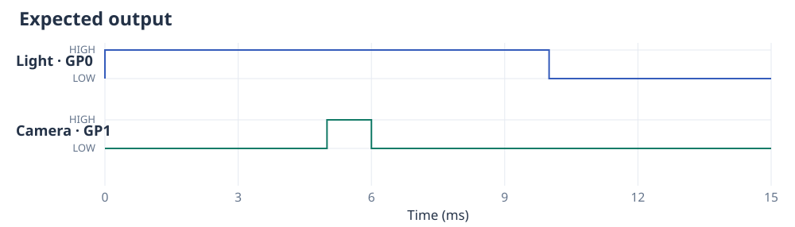

# CtrlAer

CtrlAer is a MicroPython library for controlling the timing of laboratory equipment
using RP2040/RP2350 microcontrollers, for example Raspberry Pi Pico or Pico 2.
Use it to specify when a light, valve, motor or ultrasonic device turns on, how
long it operates, and how several devices work together.

For example, an experiment might illuminate a sample for 10 milliseconds and
trigger a camera halfway through. Another might alternate two aerosol sources,
then open a valve to carry the mixture to an analyser. Each device has its own
short Python function describing what it does. CtrlAer combines those functions
so that the outputs follow the same clock.

The Pico supplies the electrical control signals. A light, motor or valve that
needs more power connects through its driver circuit. The examples explain both
the signal and the connections; you can also try the first example with an LED.

## Start here

[Getting started](getting-started.md) introduces the signal levels, explains a
complete program line by line, and shows what you should see. You will need a
Pico with MicroPython and CtrlAer installed; the [installation guide](installation.md)
walks through that setup.

Once the first example works, [controlling several devices](examples.md) shows
how to combine their timing with `mux()`. The [wiring guide](wiring.md) identifies
the Pico pins used in every example.

## Build your experiment

| I want to… | Guide |
|---|---|
| Switch an output on and off, or produce a square wave | [Getting started](getting-started.md) |
| Coordinate lights, valves or several square waves | [Controlling several devices](examples.md) |
| Start a sequence when another instrument sends a signal | [Triggers](triggers-and-groups.md) |
| Check the output using the Pico itself | [Measuring a signal](digital-capture.md) |
| Plot an experiment or save its settings and results | [Previews and records](analysis-and-records.md) |
| Choose how a long experiment is run | [Running an experiment](execution-modes.md) |
| Understand frequency, timing and memory limits | [Timing and performance](performance.md) |
| Look up an argument, return value or exception | [API reference](api-reference.md) |

The tutorials use the standard Pico pin layout, shared by the Pico and Pico 2.
Other boards using the same chips can run CtrlAer too; use their GPIO labels to
adapt the wiring.

## About the project

CtrlAer was developed for timed scientific experiments, including programmable
release of aerosols from vibrating-mesh atomisers. The
[SoftwareX paper](https://doi.org/10.1016/j.softx.2025.102175) describes the original
system and its applications. These guides also cover the subsequent additions,
including external triggers, adjustable square waves and frequency sweeps.

See [research using CtrlAer](citing.md#research-using-ctrlaer) for journal
articles and preprints describing experiments built with the library. If you
use CtrlAer in your own research, [Citing CtrlAer](citing.md) provides the
formatted reference and a BibTeX entry.
