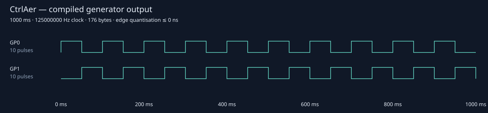
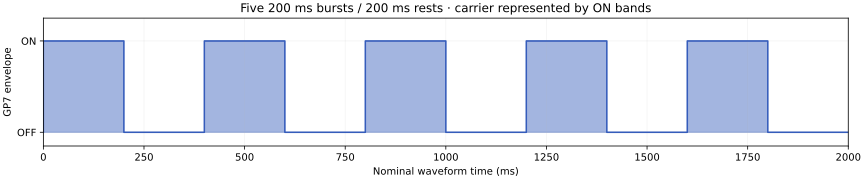
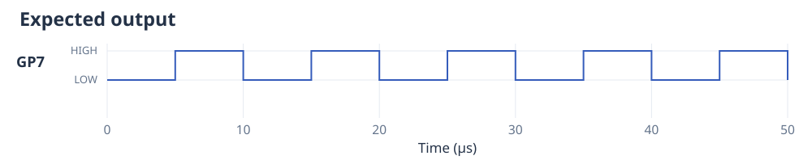
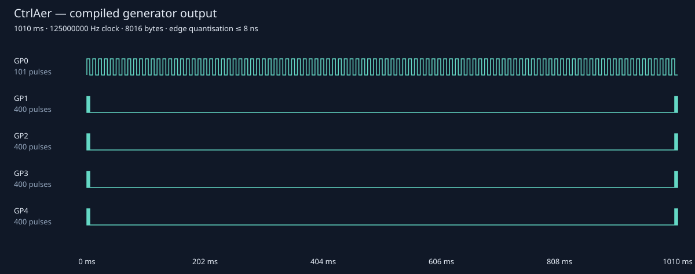
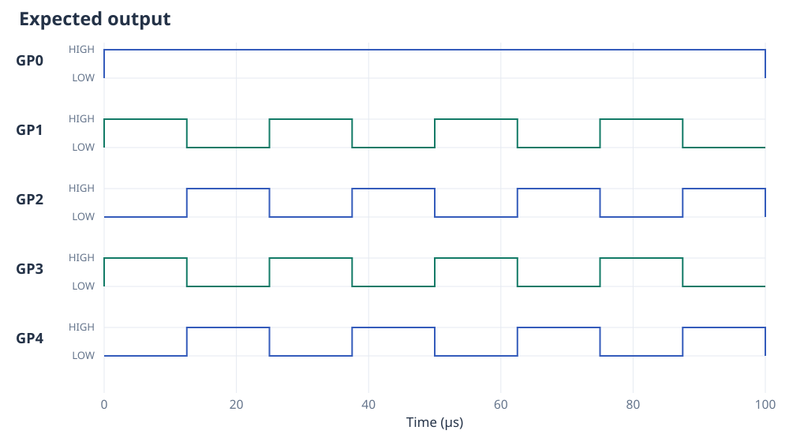
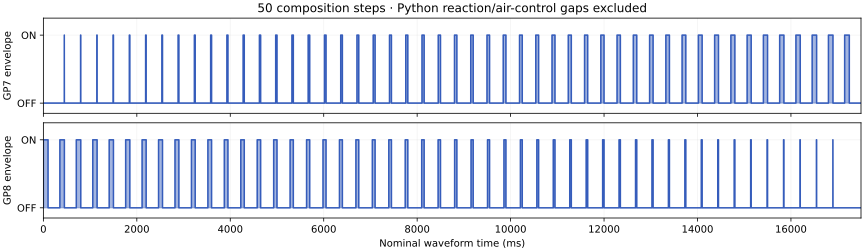
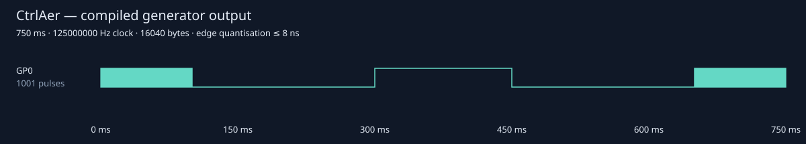

# More experiment recipes

The checkout's `examples/` directory contains programs for alternating outputs,
ultrasonic drive signals, changing reagent proportions and commands sent over
USB. This page explains what each program does and where to connect it on a
standard Raspberry Pi Pico or Pico 2.

These programs use `run()`. For a finite sequence, call `controller.block()`
afterwards to wait for the last signal to finish, then close the controller.
Close leaves the last output level in place, so finish with `OFF` when the
connected device should be off. See [Getting started](getting-started.md) for
cleanup when the program is interrupted.

The plots show the programmed timing. Dark bands represent groups of square-wave
cycles; the expanded views show individual cycles. Pauses in Python or incoming
USB commands can add time to the actual output.

## Two alternating levels — `stepper.py`

`phase1(10)` alternates 50 ms HIGH and 50 ms LOW ten times. `phase2(10)` starts
LOW and does the reverse. `mux()` places them on GP0 and GP1 for a one-second
sequence. These are constant levels; there is no high-frequency square wave in
this example.



The file name reflects its original application. The plotted phase signals must
be matched to the intended driver's input protocol and power stage. Connect
GP0/GP1 only to compatible logic inputs, with common GND. On a Pico these are
physical pins 1 and 2. A STEP/DIR driver's STEP
and DIR meanings must be considered when adapting the pattern to that driver.

## Milliseconds and cycle counts — `timing.py`

The controller square wave is 100 kHz. `step_ms()` emits five 200 ms ON sections,
each followed by 200 ms OFF. `step_ticks()` emits the same pattern with duration
20,000 and `use_ms=False`: 20,000 periods at 100 kHz is 200 ms. Running the script
submits the two sequences consecutively.





The `ticks` in this script are **square-wave periods**, not system-clock ticks.
At 100 kHz a period is 10 µs. The script uses GP7, physical pin 10 on a Pico. Connect it to a driver/probe logic input and common GND.
The envelope plot shows one of the two equivalent two-second sequences.

## Slow modulation plus complementary square waves — `ultrasonic.py`

This indefinite program multiplexes five channels at a shared 40 kHz square wave:

| GPIO | Generator | Pattern |
|---|---|---|
| GP0 | `low_freq()` | 5 ms HIGH, 5 ms LOW: a 100 Hz level waveform |
| GP1, GP3 | `phase1()` | 5 ms `PULSE01`, then 1000 ms OFF |
| GP2, GP4 | `phase2()` | 5 ms `PULSE10`, then 1000 ms OFF |





Each 5 ms square wave burst contains 200 cycles and repeats every 1005 ms. GP1/GP3
start HIGH; GP2/GP4 start LOW. These opposite phases have no programmed dead time.
Use the [explicit complementary example](examples.md#set-duty-cycle-and-complementary-dead-time)
when a driver needs a defined both-LOW handover gap.

Connect GP0 through GP4 to five compatible logic inputs and common GND. Their
physical pins on a Pico are 1, 2, 4, 5 and 6. Drivers, amplification and transducers depend on the experiment;
the GPIOs provide the plotted logic signals.

## Changing proportions with Python pauses — `blocking.py`

The source uses 50 composition steps and one repetition per step. Within a
100 ms dosing window, the amine ON duration increases from 0 to 100 ms and the
aldehyde duration decreases from 100 to 0 ms. Each window is followed by 250 ms
OFF. Both square waves use 111.5 kHz.



The horizontal axis shows programmed waveform time only. At each completed
step, the amine generator calls `ctrlaer.block()`, sleeps one second, drives the
air-control GPIO HIGH for five seconds, then LOW. Those ordinary Python pauses
and pin writes execute live as the generator advances. They pause production of
the shared `mux()` output too; the second generator is not an independently
running Python task. Console prints also run live.

The script first waits two seconds before submission. This initial delay and
the 50 reaction/air-control pauses are excluded from the envelope plot. They
cannot be previewed as hardware-timed CtrlAer sleep commands because the file
uses ordinary `time.sleep` and `machine.Pin` calls.

The script uses these connections on a Pico:

| Connection | GPIO | Pico physical pin |
|---|---|---:|
| Amine driver logic input | GP7 | 10 |
| Aldehyde driver logic input | GP8 | 11 |
| Air/valve driver logic input | GP16 | 21 |
| Logic ground | GND | 8, or another GND |

Connect only the drivers' logic inputs to the Pico; each load needs a suitable
power circuit. The two reagent signals use consecutive GP7 and GP8, while the
valve uses GP16 separately.

For new feedback programs, [eager execution](execution-modes.md#eager-measurements-and-ordinary-python-in-sequence)
lets you take a measurement after a signal finishes, then choose what to do
next. CtrlAer's `sleep`, `print` and `wait_for` instead place a pause, message or
input wait in the experiment's output sequence.

## Commands over USB — `listen.py`

The board creates a one-channel 5 kHz controller on GP0 and calls `listen(stdin)`.
While that script owns stdin, send newline-terminated `state,duration_ms` lines.
It echoes accepted commands; `END` or EOF ends the listener. An echo acknowledges
submission, rather than electrical completion. Close other serial clients before
opening the host connection.

For example, these commands request the following nominal pattern:

```text
2,100
0,200
3,150
0,200
1,100
END
```



`2` is LOW-first `ON`, `0` is OFF, `3` is constant HIGH and `1` is HIGH-first
`PULSE01`. Host pacing can add gaps, so serial arrival is not a hardware trigger.
Send a final OFF command if LOW is required before ending the session.
Connect GP0 (physical pin 1) to a compatible input and share its ground with the Pico. The host data connection is USB. See [API reference](api-reference.md)
for `listen` error handling and `block` completion semantics.
