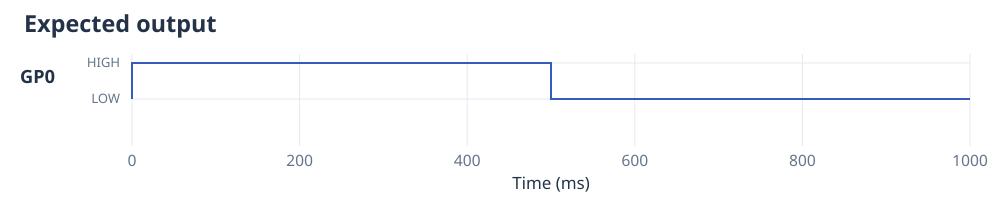
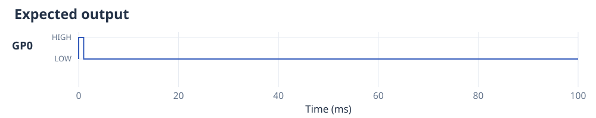
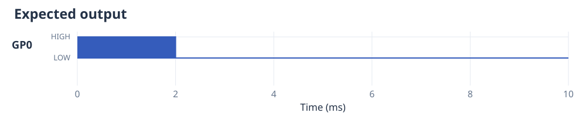
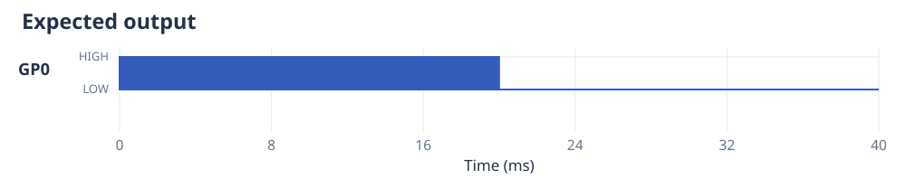
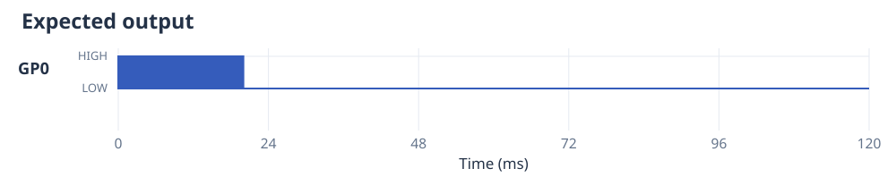

# Timing and performance

The timing you need depends on the experiment. A valve that stays open for half
a second is a different task from a 40 kHz ultrasonic drive signal. The examples
below show complete programs for repeating experiments, followed by a short
high-frequency sequence that runs once.

The diagrams show one cycle of each repeating experiment. The sizes are the
output data needed to store that cycle, calculated at a 125 MHz system clock.
They explain why holding a level costs little memory while storing every change
of a square wave costs more. A buffered run reuses its storage as it repeats;
its default waveform allocation is 96 KiB, regardless of total running time.

=== "Valve or lamp"

    Keep an output HIGH for 500 ms, then LOW for 500 ms. This is a single on/off action, not a 500 ms train of pulses.

    ```python
    from ctrlaer import CtrlAer, HIGH, OFF
    from machine import Pin

    def experiment():
        while True:
            yield HIGH, 500
            yield OFF, 500

    controller = CtrlAer(sm_number=0, base_pin=0, n_pins=1, freq=1000)
    try:
        controller.run(experiment())
    finally:
        controller.close()
        Pin(0, Pin.OUT, value=0)
    ```

    

    A stored copy of this one-second cycle takes **32 bytes**. Holding a level
    for longer barely changes its storage cost. The program above uses `run()`
    and repeats through its small hardware queue.

=== "Camera trigger"

    Give a camera a 1 ms HIGH trigger, then keep the output LOW for 99 ms. The camera’s exposure settings determine what it does in response.

    ```python
    from ctrlaer import CtrlAer, HIGH, OFF
    from machine import Pin

    def experiment():
        while True:
            yield HIGH, 1
            yield OFF, 99

    controller = CtrlAer(sm_number=0, base_pin=0, n_pins=1, freq=1000)
    try:
        controller.run(experiment())
    finally:
        controller.close()
        Pin(0, Pin.OUT, value=0)
    ```

    

    A stored copy of one 100 ms cycle takes **32 bytes**. Use `mux()` to coordinate it with illumination, or add an input trigger if the sequence should start when another instrument is ready.

=== "40 kHz ultrasound"

    Run a 40 kHz square wave for 2 ms, then pause for 8 ms. Each cycle lasts 25 µs, and there are 80 cycles in the active section.

    ```python
    from ctrlaer import CtrlAer, ON, OFF
    from machine import Pin

    def experiment():
        while True:
            yield ON, 2
            yield OFF, 8

    controller = CtrlAer(sm_number=0, base_pin=0, n_pins=1, freq=40_000)
    try:
        controller.run(experiment())
    finally:
        controller.close()
        Pin(0, Pin.OUT, value=0)
    ```

    

    The program repeats one compact `ON` instruction and one `OFF` instruction.
    Its queue stays small however long it runs. A stored copy of one complete
    cycle would take **1,304 bytes**, about 1.3 KiB, because preparation records
    each output change.

=== "100 kHz atomiser"

    Run a 100 kHz square wave for 20 ms, with each cycle HIGH for 4 µs and LOW
    for 6 µs, then pause for 20 ms. There are 2,000 cycles in the active section.
    `duty=0.4` selects the 40% HIGH time.

    ```python
    from ctrlaer import CtrlAer, square_wave, OFF

    def experiment():
        while True:
            yield square_wave(freq=100_000, duty=0.4), 20
            yield OFF, 20

    controller = CtrlAer(sm_number=0, base_pin=0, n_pins=1, freq=1000)
    try:
        run = controller.prepare(experiment, mode="buffered")
        run.start().wait()
    finally:
        controller.close()
    ```

    

    One complete cycle takes **32,016 bytes**, about 31.3 KiB, when prepared
    in advance. The buffered program above reuses its storage as it repeats.
    It uses the default 96 KiB waveform allocation; Python must keep preparing
    new sections while the output runs.

=== "Frequency sweep"

    Sweep from 90 to 120 kHz in 2 ms, return in another 2 ms, and repeat for a total of 20 ms. Follow it with a 100 ms pause.

    ```python
    from ctrlaer import CtrlAer, sweep, OFF

    def experiment():
        while True:
            yield sweep(90_000, 120_000, sweep_ms=2), 20
            yield OFF, 100

    controller = CtrlAer(sm_number=0, base_pin=0, n_pins=1, freq=1000)
    try:
        run = controller.prepare(experiment, mode="buffered")
        run.start().wait()
    finally:
        controller.close()
    ```

    

    The complete sequence needs **33,616 bytes**, about 32.8 KiB. A longer active section continues the same up-and-down frequency pattern. Buffered output keeps only a few sections ahead, so memory does not grow with total duration.

=== "Short 500 kHz signal"

    Produce 500 cycles in 1 ms, then hold LOW for 1 ms. The period is 2 µs, with one microsecond HIGH and one LOW.

    ```python
    from ctrlaer import CtrlAer, square_wave, OFF

    def experiment():
        yield square_wave(freq=500_000), 1
        yield OFF, 1

    controller = CtrlAer(sm_number=0, base_pin=0, n_pins=1, freq=1000)
    try:
        controller.prepare(experiment()).start().wait(timeout_ms=1000)
    finally:
        controller.close()
    ```

    

    The two-millisecond sequence needs **8,016 bytes**, about 7.8 KiB. Preparing a short signal avoids having to generate it continuously in Python. The program prepares this whole short signal before starting it. Continuous
    buffered operation at 500 kHz has not been measured.

The first five programs continue until you stop them. At the MicroPython REPL,
press **Ctrl-C**; each program's `finally` block stops output and leaves GP0 LOW.
The last example stops after its two-millisecond sequence.

Connect GP0 to the device's 3.3 V-compatible control input and join its ground to
Pico GND. The [first tutorial](getting-started.md) uses the built-in LED and
also shows an external-LED circuit for trying a slow signal on GP0. To inspect
individual square-wave cycles, use [digital capture](digital-capture.md) or an
oscilloscope.

## Timing resolution

Prepared and buffered output changes occur on the Pico's system clock. At
125 MHz one clock tick is 8 ns, and the state machine requires at least six ticks
between changes: 48 ns. At 150 MHz the corresponding interval is 40 ns.
The compiler rejects requested intervals that are too short.

The original `ON` command uses a repeating hardware loop and a frequency divider.
Its actual frequency can differ slightly from the request. Durations for integer
commands are whole periods of the controller's `freq`; for example, at 40 kHz
one period is 25 µs. `square_wave()` and `sweep()` instead round their changes to
system-clock ticks. The prepared program's summary reports that rounding.

Input synchronisation and trigger-control instructions add a fixed delay after
an external trigger. [Triggers](triggers-and-groups.md) explains that delay.
Console messages and software timeouts also depend on when Python handles them;
use [digital capture](digital-capture.md) to measure pin timing.

## Repeating a signal continuously

A buffered square wave needs two output changes per cycle. At 40 kHz that is
80,000 changes per second; at 100 kHz it is 200,000. This is what a benchmark
means by “edges per second”. The useful question is whether the **whole running
program** can prepare those changes quickly enough, including its sensor reads,
messages and other work.

More buffer memory gives Python more time to recover from a pause. It cannot
make up for a function that is consistently too slow. If preparation falls
behind, CtrlAer stops and reports `UnderrunError`. For a known short sequence,
preparing all of it first removes that ongoing Python workload. For measurements
between actions, [eager execution](execution-modes.md#eager-measurements-and-ordinary-python-in-sequence)
allows variable gaps while Python works.

## What has been measured?

The sustained tests focused on roughly 100 kHz because that is the operating
range of the vibrating-mesh atomisers used in the lab. They cover fixed-frequency
square waves, sweeps and repeated on/off operation. They do not determine a
maximum rate for every possible experiment.

| Workload | Recorded continuous test |
|---|---|
| 108.05 kHz square wave | At least 30 s on each chip, without a buffer underrun |
| 90–120 kHz sweep, 2 ms or 20 ms per direction | At least 30 s on each chip, without a buffer underrun |
| 90.001–120 kHz sweep, 2 ms per direction | At least 30 s on each chip, without a buffer underrun |
| Repeated 20 ms square waves or sweeps, with 20 ms LOW between them | At least 30 s on each chip, without a buffer underrun |

The records are from 10 November 2026: an RP2040 at 125 MHz (Pimoroni Tiny 2040,
MicroPython 1.29.0) and an RP2350 at 150 MHz (Pimoroni Pico Plus 2, firmware
1.29.0-2 with PSRAM). They are historical measurements of the recorded source
versions. The detailed results, firmware identities and source hashes are in
the checkout's `tests/hardware/validation-2026-11-10.json`.

For the 90–120 kHz sweep with 2 ms per direction, the recorded time from a fresh
import to first output was about 366 ms on RP2040 and 291 ms on RP2350 for a
finite prepared run, or 421 ms and 354 ms with buffering. This is preparation
time before the experiment, separate from the timing of its output.

Install the compiled library with the [installer](installation.md) to avoid
recompiling its native routines on every restart. Then try your actual waveform
and application workload: it is more useful than comparing isolated arithmetic
benchmark rates.
