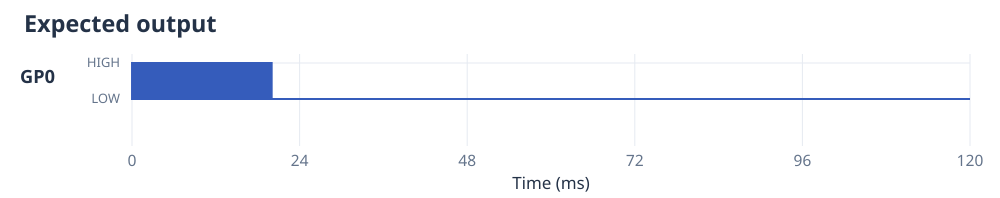
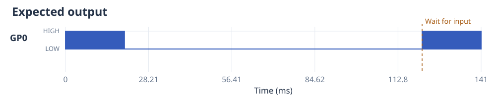

# Finite prepared execution

Generators yielding `(command, duration)` remain the sole experiment-authoring
interface. Existing constants, `mux()` and ordinary Python control flow remain
supported. This guide covers `prepare(program, mode="finite")`, the default:
it compiles a complete program or an explicitly bounded window before starting.
For an indefinite program, use [buffered execution](execution-modes.md); eager
execution keeps Python measurements in sequence with completed commands.

```python
from ctrlaer import CtrlAer, ON, OFF

def experiment():
    yield ON, 20
    yield OFF, 100

controller = CtrlAer(0, 0, 1, freq=108050)
try:
    run = controller.prepare(experiment())
    run.start()
    # Python is free to handle measurements while hardware plays the buffer.
    run.wait(timeout_ms=1000)
finally:
    controller.close()
```



GP0 is the output. No external connection is needed to run it; connect a
compatible logic input to GP0 and common GND when using a driver or probe.
See [physical pin positions](wiring.md).

Preparation interprets the generator and validates its compiled buffer before
claiming GPIO. Outputs are then initialised LOW, DMA preloads complete packets,
and PIO remains disabled until `start`. Completion comes from a terminal PIO
instruction, not FIFO emptiness or the end of a DMA transfer. `abort` stops the
run and drives `final_mask` (one bit per output, default all LOW). `rearm` reuses an
inactive open run. `close` releases execution resources and leaves final levels
driven; explicitly configure pins as inputs to release electrical drive as well.

The controller's `start`, `wait` and `abort` delegate to its prepared run. Errors
stop execution and drive the configured final mask. `status` includes execution
state, error, underrun status, and service-observed gate/print events.

## One command vocabulary

```python
from ctrlaer import chirp, pulse, OFF, sleep, print, wait_for

def experiment(pulse_ms=20, sweep_ms=2):
    print("beginning shot")
    yield chirp(90000, 120000, sweep_ms=sweep_ms), pulse_ms
    yield OFF, 1
    sleep(0.1)                 # seconds, like time.sleep
    wait_for(6, timeout_ms=1000)
    yield pulse(108050, duty=0.4), 20
```



This factory is portable for analysis. For hardware, configure GP6 as an input
before preparing it; GP0 is output. The dashed marker shows the gate at its
nominal position; unknown external waiting time is additional.

CtrlAer-owned `sleep`, `print`, and `wait_for` calls have small scoped handlers.
During analysis/preparation, sleep becomes a timed hold, print becomes an annotation
and deferred print event, and wait becomes a PIO gate. Playback handles those
effects at their recorded boundaries. Print notification uses the runtime service
and can lag the hardware boundary. Sleep holds the last **digital levels**; it
does not extend a finished carrier. Yield OFF first when an inactive delay is
required. These effects are global barriers within a multiplexed program; use
independent grouped state machines when one channel must wait independently.

Ordinary Python still executes normally. Global mutations, third-party I/O,
`time.sleep`, and built-in `print` are not intercepted. Analysis is not a sandbox
and does not attempt to undo arbitrary side effects. Use the CtrlAer vocabulary
for effects you want interpreted, and accept responsibility for other Python calls.
The scoped handler is intended for one interpreter thread at a time.

Original FIFO `run(program)` handles CtrlAer sleep/print by draining prior
commands first and performing the effect live. It accepts integer commands;
use finite, buffered or eager execution for rich carriers and hardware
`wait_for`. All retain the same generator protocol.

## Bounds, timing and memory

```python
from ctrlaer import compile_program

# A factory receives normal keyword arguments. An iterator is consumed directly.
program = compile_program(experiment, parameters={"pulse_ms": 20, "sweep_ms": 2})
run = controller.prepare(program)

# Bound an infinite generator without changing its authoring vocabulary.
def indefinite():
    while True:
        yield OFF, 1000

program = compile_program(indefinite(), window_ms=100, max_words=8192)
```

`window_ms` explicitly clips one finite prepared window. It does not refill an
unbounded stream automatically, and consuming a crossing command does not preserve
its remainder for a subsequent call. `max_words` and `max_segments` are hard guards;
exceeding either raises an error rather than silently truncating a program.
Unbounded external gate waiting time is additional to the nominal window.

The prepared engine uses system-clock ticks and two 32-bit words per edge interval.
The minimum interval is six ticks (48 ns at 125 MHz). Adjacent equal states merge;
long constant holds split safely. Impossible short pulses and dead-time gaps are
rejected before arming. Fixed control overhead from effect markers/gates is reported
separately. Rounding residue is carried between managed sleeps/rich segments.
Control packets each occupy 512 ticks to pace bursts from RP2350 PSRAM. For
example, the three packets between a released wait and the first output add
10.24 us at 150 MHz (12.288 us at 125 MHz), plus GPIO synchronisation. The full
gate's nominal overhead is included in the summary. Six ticks is an encoding
minimum; sustained playback also needs enough DMA/memory bandwidth, particularly
with PSRAM or competing peripherals. Stalls remain explicit errors.

Finite prepared carriers use memory per edge; the original FIFO oscillator is
compact, and buffered execution retains a fixed waveform pool.
The default limit is 32768 words (128 KiB), and available heap may require a lower
limit. A 20 ms 90–120 kHz triangular chirp uses about 33 KiB. Compile on the desktop
if useful, using the device's exact system clock; changing the clock requires
recompilation. `set_freq` applies to the original FIFO engine; a prepared buffer has
immutable precomputed frequencies.
On MicroPython, compilation temporarily lowers the garbage-collection threshold
to keep short-lived edge calculations from fragmenting the heap, then restores
the caller's setting, including when compilation fails.

Unexpected transmit or effect-buffer stalls report `UnderrunError`. Completion,
gate timeouts and print effects use a soft timer (default 1 ms). Waveform edges
and input waits run in PIO, independently of Python notification latency.

The original integer commands retain their two-bit-plane encoding and duration
conversion. `PULSE10`/ON outputs LOW then HIGH; `PULSE01` outputs HIGH then LOW.
Explicit `pulse`/`chirp` commands begin with their specified rising-edge phase
delay and use clock-resolution timing. `mux` preserves a rich command's phase and
sweep progress when other channels divide it into shorter segments.
