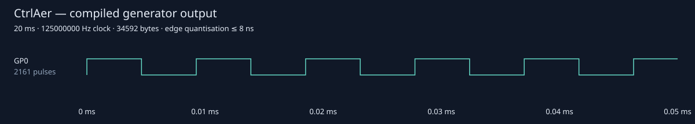
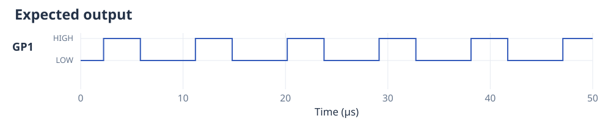

# Triggers, gates and coordinated waveforms

All examples use the existing generator protocol. No separate declarative
experiment language or builder is needed.

## Hardware inputs

Connect a 3.3 V trigger source to GP6 and common GND; GP0 is the drive
output. See the [physical wiring guide](wiring.md#trigger-an-experiment).

```python
from ctrlaer import CtrlAer, ON, OFF, Trigger, wait_for
from machine import Pin

Pin(6, Pin.IN, Pin.PULL_DOWN)

def experiment():
    yield ON, 20
    yield OFF, 1
    wait_for(6, level=1, timeout_ms=1000)
    yield ON, 20

controller = CtrlAer(0, 0, 1)
try:
    run = controller.prepare(experiment(), trigger=Trigger(6, timeout_ms=5000))
    run.start().wait(timeout_ms=10000)
finally:
    controller.close()
```

An initial `Trigger` waits before the generator's first output command. `wait_for` adds
a gate at a generator boundary. Rising-edge waits require LOW followed by HIGH;
an already HIGH input is not a new rising edge. Falling waits do the reverse.
Level waits release immediately if the requested level is already present.
Configure external input pads before preparing. Another controller's output can
also be observed without changing its GPIO direction.

WAIT instructions execute in PIO. Their output response does not depend on Python
polling. Marker packets identify active gates and add fixed reported overhead.
Unknown external waiting time is additional. Gates hold the last digital levels;
explicitly yield OFF before waiting when that is the intended output.

Timeouts are supervised by the runtime's soft timer. The timeout starts when its
entry marker is serviced, so notification/abort includes timer and interpreter
latency. `GateTimeoutError` identifies the failed gate and drives `final_mask`.
`None` allows an unbounded wait. `gate_history` contains service-observed times;
use digital capture for hardware-sampled transition timestamps.

## Retriggering

```python
from ctrlaer import CtrlAer, pulse, OFF, wait_for
from machine import Pin

Pin(6, Pin.IN, Pin.PULL_DOWN)

def shots(n_shots=10):
    for _ in range(n_shots):
        wait_for(6, timeout_ms=5000)
        yield pulse(108050), 20
        yield OFF, 100

controller = CtrlAer(0, 0, 1)
try:
    run = controller.prepare(shots, mode="buffered")
    run.start().wait(timeout_ms=60000)
finally:
    controller.close()
```

Ten shots can exceed a Tiny's finite waveform budget. Buffered mode retains
bounded lookahead while preserving the hardware gate before every burst.


The next input edge must arrive after the next gate is ready to observe LOW/HIGH;
edges during an active pulse are not queued. Completed or aborted open runs can
also be explicitly `rearm()`ed.
See the [triggered-shot gallery](examples.md#wait-for-another-trigger-on-every-shot)
for a complete indefinite example and its nominal waveform plot.

## Independent waveform groups

```python
from ctrlaer import CtrlAer, Group, pulse

def atomiser_a():
    yield pulse(108050), 20

def atomiser_b():
    yield pulse(111500, duty=0.4, phase=0.25), 20

a, b = CtrlAer(0, 0, 1), CtrlAer(1, 1, 1)
group = Group([a.prepare(atomiser_a()), b.prepare(atomiser_b())])
try:
    group.start().wait(timeout_ms=1000)
finally:
    group.close()
```

The first 50 µs of each independently compiled member use the same time axis:





Connect GP0 and GP1 to separate driver logic inputs and common GND. They are
physical positions 16/15 on the Tiny and 1/2 on the Pico Plus 2; see
[wiring](wiring.md). Group timing permits edge crossings that a single merged
engine could not represent.

One atomic enable/divider-reset write starts all group members in one PIO block.
Each has an independent schedule/frequency and its own final mask. A member error
aborts other active members. RP2350 can also start members across all three PIO
blocks atomically using its neighbour-control registers. On RP2040, cross-block
groups need the same initial hardware trigger: arm the group first, then provide
the common external edge. RP2040 cross-block groups without that trigger fail.

Multiple carriers can also share one `mux`. Their merged edges must fit the
six-tick minimum interval. Separate grouped state machines allow independent
carriers whose edges would otherwise approach too closely.

## Duty cycle, phase and complementary dead time

```python
from ctrlaer import pulse, mux

def drive_a():
    yield pulse(108050, duty=0.5, dead_time_ns=200), 20

def drive_b():
    yield pulse(108050, duty=0.5, complement=True, dead_time_ns=200), 20

program = mux([drive_a(), drive_b()])
```

`phase` delays the first ideal rising edge by a fraction of a carrier cycle, in
[0, 1). `duty` is strictly between 0 and 1. A complementary partner uses the same
options and `complement=True`. Both turn off at their ideal falling edges and turn
on after the specified dead time; both are LOW during the gap. Invalid duty,
phase, dead time and unrepresentably short intervals fail during preparation.

## Repeated adiabatic sweeps

```python
from ctrlaer import chirp, OFF

def adiabatic(pulse_ms=20, sweep_ms=2):
    yield chirp(90000, 120000, sweep_ms=sweep_ms), pulse_ms
    yield OFF, 100
```

`sweep_ms` is one traversal from the first frequency to the second. An equal-time
return traversal follows, producing a triangle in frequency. The default is a
20 ms one-way traversal. Sweep rate is independent of pulse duration: the example
spends 2 ms going up, 2 ms going down, and repeats for the whole 20 ms ON section.
A shorter pulse clips that same frequency trajectory; it does not rescale it.


Edges come from the integral of the piecewise-linear frequency, preserving phase
through reversals and `mux` boundaries. Playback uses DMA rather than CPU-timed
divider writes. The example contains 2100 cycles in five complete triangles.
Reusing a chirp command in a new yielded ON section starts a fresh sweep. This
defines the electrical drive; atomiser response still needs lab evaluation.
