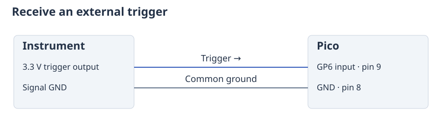
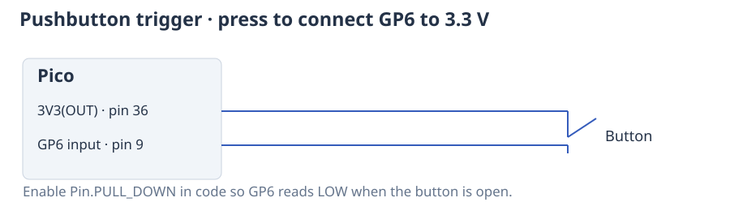

# Start an experiment from an external signal

A trigger is an electrical signal that tells an experiment when to start. For
example, a camera may signal that it is ready, or a detector may signal that a
sample has arrived. A gate is a wait inside the experiment: the outputs reach
that point, then wait for another input before continuing.

Connect the trigger source to GP6 and connect its ground to Pico GND. GP6 is
physical pin 9 on a standard Pico; use a 3.3 V logic signal. See the
connections below.



To use a button instead, connect a normally open button between **3V3(OUT)
(pin 36)** and **GP6 (pin 9)**. The input pull-down in the code keeps GP6 LOW
when the button is open. This is an alternative to the instrument connection.



A button can bounce. Use it to try the example by hand; use an electronic
trigger when checking precise repeated timing.

## Wait before starting

This example waits up to five seconds for GP6 to change from LOW to HIGH, then
produces a 2 ms square wave on GP0.

```python
from ctrlaer import CtrlAer, ON, OFF, Trigger
from machine import Pin

Pin(6, Pin.IN, Pin.PULL_DOWN)

def experiment():
    yield ON, 2
    yield OFF, 8

controller = CtrlAer(sm_number=0, base_pin=0, n_pins=1, freq=40_000)
try:
    run = controller.prepare(experiment(),
                             trigger=Trigger(pin=6, timeout_ms=5000))
    run.start().wait(timeout_ms=6000)
finally:
    controller.close()
```

`start()` makes the experiment ready; it does not bypass the trigger. The Pico's
PIO hardware watches the input, so a busy Python interpreter does not have
to notice the edge before output can begin. Control instructions add a short
fixed delay between the input and output; at 125 MHz, the three instructions
after the wait take 12.288 µs, plus input synchronisation.

## Wait again for each repetition

Use `wait_for()` inside the function when each repetition needs a new signal.
The following experiment can continue until you interrupt it:

```python
from ctrlaer import CtrlAer, square_wave, OFF, wait_for
from machine import Pin

Pin(6, Pin.IN, Pin.PULL_DOWN)

def shots():
    while True:
        wait_for(pin=6)
        yield square_wave(freq=40_000), 2
        yield OFF, 8

controller = CtrlAer(sm_number=0, base_pin=0, n_pins=1)
try:
    run = controller.prepare(shots, mode="buffered")
    run.start().wait()
finally:
    controller.close()
```

The output waits at its last level, so the `OFF` instruction makes sure GP0 is
LOW between repetitions. Pulses that arrive during output or the eight-millisecond
pause are ignored. The next wait must first see LOW, then a new HIGH.

For a fixed number of repetitions, replace `while True` with
`for _ in range(10)`. A completed or aborted run can also be restarted with
`run.rearm()` followed by `run.start()`.

## Choose what counts as a trigger

| Request | Meaning |
|---|---|
| `wait_for(pin=6)` | Wait for LOW followed by HIGH |
| `wait_for(pin=6, edge="falling")` | Wait for HIGH followed by LOW |
| `wait_for(pin=6, level=1)` | Continue when HIGH, including if it is already HIGH |
| `wait_for(pin=6, level=0)` | Continue when LOW, including if it is already LOW |

`Trigger` accepts the same options. By default there is no time limit. A
`timeout_ms` causes a `GateTimeoutError` if the input does not arrive, and the
outputs are set to `final_mask` (LOW by default). Python supervises this timeout,
so a long Python operation can delay it. Use the timeout to detect a failed
experiment; it is not an independent hardware cutoff.

## Coordinate channels with `mux()`

For most experiments with several outputs, use `mux()`. It combines one function
per channel into a single schedule, sharing one PIO state machine. A wait in any
channel pauses that whole schedule. This is useful when all devices should
wait together for a sample to arrive.

The [multi-device examples](examples.md) show lights, camera triggers and square
waves combined this way.

## Let one channel wait independently with `Group`

Use `Group` when channels need separate waits or when independently timed square
waves have output changes too close together for one PIO state machine. Each member
uses a separate controller and more hardware resources. Starting the group
starts its members together; it does not combine their instructions.

```python
from ctrlaer import CtrlAer, Group, square_wave

def drive_a():
    yield square_wave(freq=40_000), 2

def drive_b():
    yield square_wave(freq=41_000, duty=0.4), 2

a = CtrlAer(sm_number=0, base_pin=0, n_pins=1)
b = CtrlAer(sm_number=1, base_pin=1, n_pins=1)
try:
    group = Group([a.prepare(drive_a()), b.prepare(drive_b())])
    group.start().wait(timeout_ms=1000)
finally:
    a.close()
    b.close()
```

GP0 and GP1 connect to the two driver inputs. PIO state machines 0 and 1 are in the
same PIO block and start in one hardware operation. An error in one member stops
the others. On RP2040, members in different PIO blocks need a common initial
hardware trigger; start the group first, then send that trigger. RP2350 can also
start members across its PIO blocks together without an external trigger.

## Adjust a square wave or sweep its frequency

The [signal examples](examples.md) explain duty cycle, complementary outputs,
dead time and repeated frequency sweeps, with code and diagrams. These describe
the output signal. The response of the attached light, motor or transducer must
be checked with that device.
