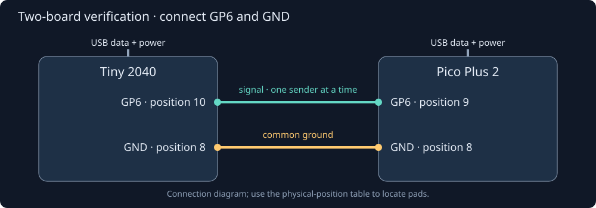

# Pins and physical connections

CtrlAer uses **GPIO numbers**: `base_pin=6` means GP6. Header position 6 is a
different pin. With multiple channels, the next channel uses the next GPIO, so
`base_pin=6, n_pins=2` drives GP6 and GP7.

## Find the right pad

The table below uses a component-side view with the USB connector at the top.
On the Tiny, header positions run down the left side from 1 to 8 and up the
right side from 9 to 16. On the Pico Plus 2 they run down the left from 1 to 20
and up the right from 21 to 40.

| GPIO / connection | Tiny 2040 physical position | Pico Plus 2 physical position |
|---|---:|---:|
| GP0 | 16 | 1 |
| GP1 | 15 | 2 |
| GP6 | 10 | 9 |
| GP7 | 9 | 10 |
| GND used in the diagram | 8 | 8 |
| Alternative GND | 2 | 3 |
| 3V3 output | 3 | 36 |

Verify orientation against the manufacturer's
[Tiny 2040 pinout](https://cdn.shopify.com/s/files/1/0174/1800/files/tiny-2040-pinout-diagram_4dd9e9ab-6f6f-4b63-82d4-16793d109f17.png?v=1614260173)
and [Pico Plus 2 pinout](https://cdn.shopify.com/s/files/1/0174/1800/files/ppico_plus_2_pinout_diagram.pdf?v=1723557334).
The Tiny's GP8/GP9 are not exposed on its headers. Hardware regression scripts
can observe those pads internally, but they are unsuitable instructions for
external jumper wiring.

## Two boards: send and verify in either direction

Power each board over its own USB data cable. Add just these two connections:

| Tiny 2040 | Pico Plus 2 | Purpose |
|---|---|---|
| GP6, position 10 | GP6, position 9 | Digital signal |
| GND, position 8 | GND, position 8 | Shared signal reference |



The diagram shows connections, rather than a scaled board layout. Other GND
pads in the table are equivalent. The 3V3, VBUS and VSYS supply rails are not
part of this USB-powered link.

Only the sender configures GP6 as an output. The receiver observes GP6 as an
input. The test tools return both pads to inputs before exchanging roles and
after the test. A state machine driving a pad can coexist with an input sampler
observing that same pad; do not separately reconfigure it as `Pin.IN` while it
is being driven.

With the current checkout installed on both boards:

```sh
python3 tools/cross_board.py \
  --tiny-port /dev/cu.usbmodem3101 --pico-port /dev/cu.usbmodem101 \
  --gpio 6 --no-leds --out-dir work/cross-board
```

Replace the example port names with those enumerated by
`uv run tools/install.py --list`. This test sends a marker, fixed-frequency
bursts and a triangular chirp, then compares the peer's captured edges with the
compiled schedule. It repeats with the roles reversed. See
[performance](performance.md) for the waveform and acceptance limits.

## Trigger an experiment

The trigger examples use **GP6 as input** and **GP0 as drive output**. Connect
your trigger source's 3.3 V logic output to GP6 and its ground to board GND.
Connect GP0 to the logic input of your experiment's driver. Its logic ground
also joins board GND. Configure `Pin(6, Pin.IN, Pin.PULL_DOWN)` before preparing
the program; do not use GP6 as one of that controller's outputs.

For a manual trial, a momentary switch between the board's 3V3 pin and GP6
can supply a rising edge with that pull-down configuration. Mechanical contact
bounce can produce several edges; use a clean external logic source when
checking trigger timing or retriggering. See [trigger semantics](triggers-and-groups.md).

## Observe a waveform without a second board

`DigitalCapture` can sample a controller's own output pad using another state
machine, with no loopback jumper. Give it the output's GPIO and a different
`sm_number`. This checks relative edge timing using a shared oscillator. The
two-board link additionally uses independent oscillators; neither measurement
establishes analogue drive quality or atomiser behaviour.

## Connect an external load

The GPIO supplies 3.3 V logic. Connect it to a compatible driver input and
connect the logic grounds. A motor, valve, bridge power stage or atomiser needs
its own suitable power driver and supply. The examples specify the digital
waveform at the driver input; choosing the power circuit depends on the load.
