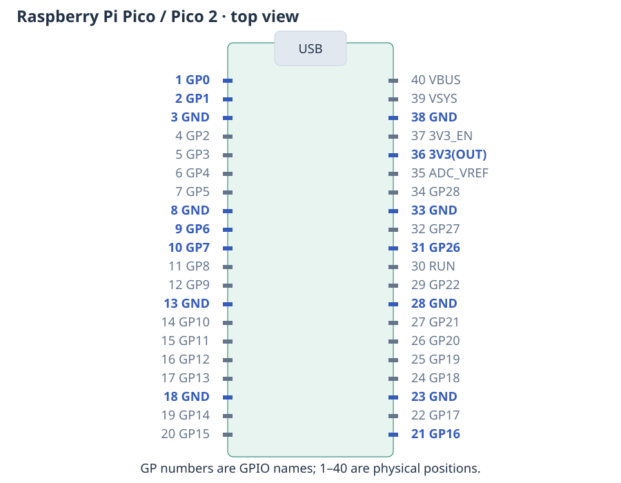

# Connecting a Raspberry Pi Pico

A CtrlAer program controls the Pico's **GPIO pins**. These carry 3.3 V logic
signals: HIGH is approximately 3.3 V and LOW is approximately 0 V. Connect the
signal to the control input of your instrument or driver, and connect their
grounds so that both devices use the same voltage reference.

This page uses the standard **Raspberry Pi Pico and Pico 2** layout. Place the
board with its components facing you and the USB connector at the top. The left
row is numbered from 1 at the top to 20 at the bottom; the right row continues
from 21 at the bottom to 40 at the top.

## GPIO names and physical positions

The name printed on the board is the one used in Python. For example,
`base_pin=0` selects **GP0**, at physical pin 1. `base_pin=6` selects **GP6**, at
physical pin 9. The number after `GP` and the header position are different
numbering systems.

| Printed label | Physical pin | Used for |
|---|---:|---|
| GP0 | 1 | External output in the waveform and driver examples |
| GP1 | 2 | Second output in two-channel examples |
| GND | 3 | Ground for an LED, driver or instrument |
| GP2, GP3, GP4 | 4, 5, 6 | Additional output channels |
| GND | 8 | A convenient ground near the trigger input |
| GP6 | 9 | Trigger input in the tutorials |
| GP7 | 10 | An alternative output or input |
| GP16 | 21 | Valve-control output in the older dosing example |
| GP25 | Built into board | LED on a non-wireless Pico or Pico 2 |
| GP26 | 31 | Analogue sensor input in the measurement example |
| 3V3(OUT) | 36 | 3.3 V supply for the push-button example |

The [official Pico/Pico 2 pinout](https://pip-assets.raspberrypi.com/categories/1005-raspberry-pi-pico-2/documents/RP-008301-DS-1-Pico-2-Pinout.pdf?disposition=inline)
shows every pin and its other uses. For a different board, find the **same GPIO
label** on that board's pinout; its physical position may be different.

## Which connections do I need?

Follow the connections in the example you are running. They are alternatives,
not a setup checklist. The built-in LED example needs only USB. Later examples
give their own connections immediately before or after the code:

| Example | Connections |
|---|---|
| [First LED flashes](getting-started.md#flash-the-built-in-led) | USB only on a Pico or Pico 2; an optional external LED circuit is shown there too |
| [Light and camera](examples.md) | GP0 to the light driver, GP1 to the camera trigger, and common GND |
| [External trigger](triggers-and-groups.md) | Trigger output to GP6, output to the controlled device on GP0, and common GND |
| [Light and sensor](examples.md#use-python-measurements-between-commands) | GP0 to the light driver, sensor output to GP26, and common GND |
| [Measure a signal](digital-capture.md) | No extra wiring to measure the Pico's own output; the second-Pico connection is explained in that example |

Pico GPIOs carry 3.3 V control signals. A driver powers a light, motor, valve or
transducer; the GPIO connects to its control input. Join the devices' signal
grounds, and check that an external output is suitable for a 3.3 V Pico input.
